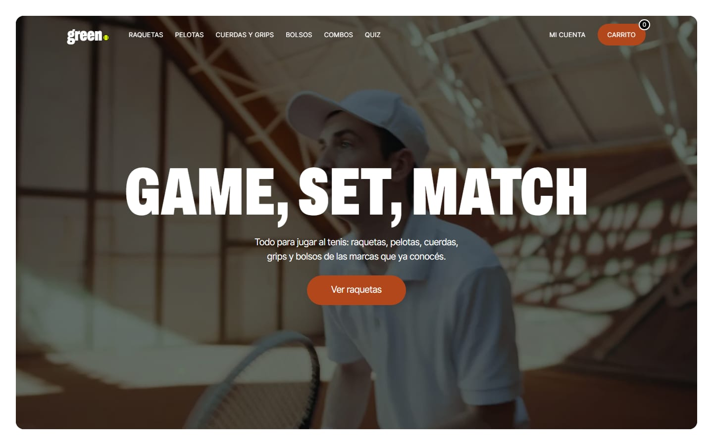
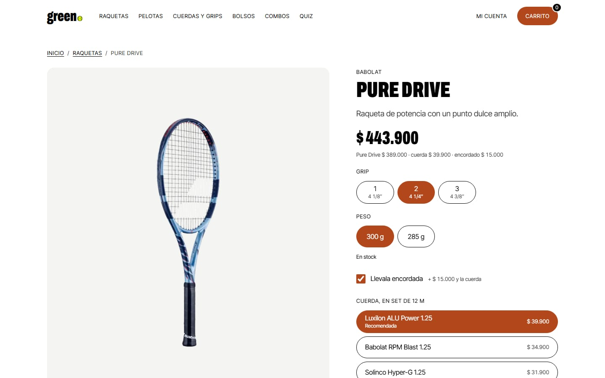
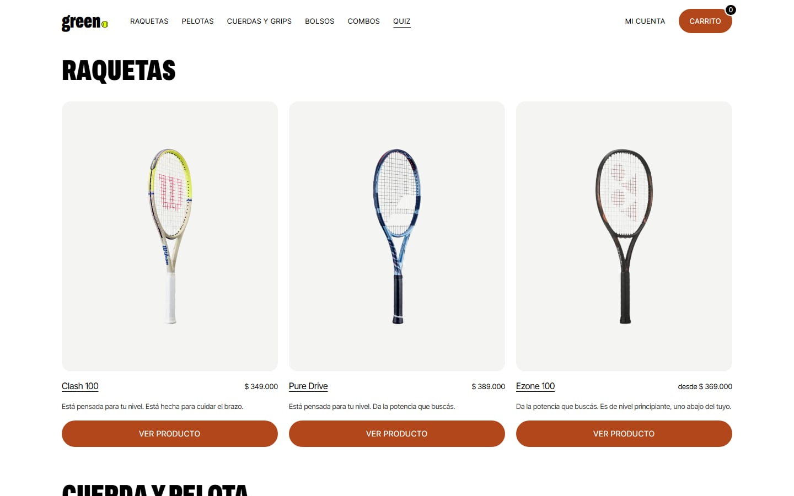

[](https://github.com/alanfvidela-wq/green-tenis/actions/workflows/ci.yml)

# green.

Tienda online de tenis: raquetas, pelotas, cuerdas, grips y bolsos de marcas
reales, más combos con descuento, encordado a medida y un quiz que recomienda
un kit según cómo jugás. **En vivo: [green-tenis.vercel.app](https://green-tenis.vercel.app)**

| Home | Ficha de producto | Quiz |
| ---- | ----------------- | ---- |
|  |  |  |

## Funcionalidades

- Catálogo por categoría con fichas técnicas, fotos por variante y medidores.
- Raquetas con grip y peso a elección, y encordado con cuerda y tensión.
- Carrito con precios, descuentos y stock calculados en el servidor.
- Cuenta (registro, ingreso, recuperar contraseña) y «Mis pedidos».
- Checkout con Mercado Pago (Checkout Pro) y webhook firmado.
- Quiz de seis preguntas que arma un kit con el porqué de cada producto.
- Administración: productos (crear, editar, borrar) y estados de pedidos.
- API REST en `/api/v1`, validada con Zod.

## Stack

Next.js 16 (App Router) · React 19 · JavaScript · CSS Modules · Supabase
(Postgres con RLS, Auth, Storage, pg_cron) · Mercado Pago · Zod · Playwright ·
GitHub Actions · Vercel y Speed Insights. Detalle y diagramas:
[docs/ARQUITECTURA.md](docs/ARQUITECTURA.md).

## Cómo levantarlo en local

1. Clonar e instalar:

   ```bash
   git clone https://github.com/alanfvidela-wq/green-tenis.git
   cd green-tenis
   npm install
   ```

2. Copiar `.env.example` a `.env.local` y completar las variables (Supabase y
   Mercado Pago; qué es cada una, en [docs/API.md](docs/API.md)).
3. En el SQL Editor de Supabase, correr en orden las migraciones de
   `supabase/migrations/` (de `0001` a `0011`) y después `supabase/seed.sql`.
4. `npm run dev` y abrir [http://localhost:3000](http://localhost:3000).

## Tests

```bash
npx playwright install chromium   # la primera vez
npm run test:e2e                  # todos (arma el build y levanta el servidor)
npm run test:e2e:ci               # los del CI: sin los que escriben en la base
```

El de checkout necesita `E2E_EMAIL` y `E2E_PASSWORD` en `.env.local` (una
cuenta de prueba). Más en [docs/TESTING.md](docs/TESTING.md).

## Documentación

- [docs/ARQUITECTURA.md](docs/ARQUITECTURA.md): stack, arquitectura, base de datos e historia.
- [docs/API.md](docs/API.md): los endpoints, el pago con Mercado Pago y la seguridad.
- [docs/TESTING.md](docs/TESTING.md): tests E2E, casos de prueba manuales y reportes de bug.
- [docs/CI.md](docs/CI.md): el pipeline de GitHub Actions y Speed Insights.
- [docs/FOTOS.md](docs/FOTOS.md): cómo se cargan y procesan las fotos.

---

This is a [Next.js](https://nextjs.org) project bootstrapped with [`create-next-app`](https://nextjs.org/docs/app/api-reference/cli/create-next-app).

## Getting Started

First, run the development server:

```bash
npm run dev
# or
yarn dev
# or
pnpm dev
# or
bun dev
```

Open [http://localhost:3000](http://localhost:3000) with your browser to see the result.

You can start editing the page by modifying `app/page.js`. The page auto-updates as you edit the file.

This project uses [`next/font`](https://nextjs.org/docs/app/building-your-application/optimizing/fonts) to automatically optimize and load [Geist](https://vercel.com/font), a new font family for Vercel.

## Learn More

To learn more about Next.js, take a look at the following resources:

- [Next.js Documentation](https://nextjs.org/docs) - learn about Next.js features and API.
- [Learn Next.js](https://nextjs.org/learn) - an interactive Next.js tutorial.

You can check out [the Next.js GitHub repository](https://github.com/vercel/next.js) - your feedback and contributions are welcome!

## Deploy on Vercel

The easiest way to deploy your Next.js app is to use the [Vercel Platform](https://vercel.com/new?utm_medium=default-template&filter=next.js&utm_source=create-next-app&utm_campaign=create-next-app-readme) from the creators of Next.js.

Check out our [Next.js deployment documentation](https://nextjs.org/docs/app/building-your-application/deploying) for more details.

## Créditos

Las microanimaciones de green. (el esqueleto del carrito, la insignia del
carrito, el aviso «Agregado al carrito», el selector de cantidad, el chequeo de
pago aprobado y la entrada escalonada de la vitrina) están inspiradas en
[Kinetics](https://kinetics.colorion.co), la biblioteca de animaciones de
interfaz de [Csaba Kissi](https://github.com/ckissi/kinetics). El código es
propio y replica los tiempos, las curvas, las escalas y las distancias de cada
efecto; cada archivo enlaza al efecto en el que se inspira:

- [Skeleton to Content](https://kinetics.colorion.co/effects/skeleton-to-content/)
- [Badge Counter](https://kinetics.colorion.co/effects/badge-counter/)
- [Toast Overshoot](https://kinetics.colorion.co/effects/toast-overshoot/)
- [Quantity Stepper](https://kinetics.colorion.co/effects/quantity-stepper/)
- [Success Check](https://kinetics.colorion.co/effects/success-check/)
- [Stagger Entrance](https://kinetics.colorion.co/effects/stagger-entrance/)
