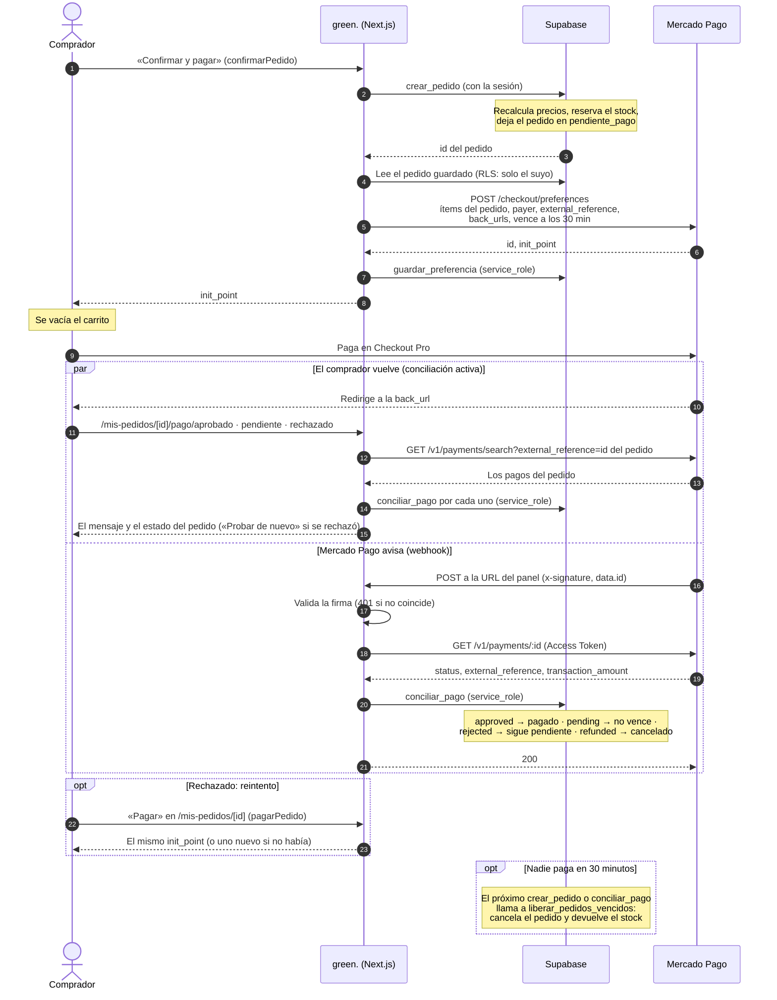
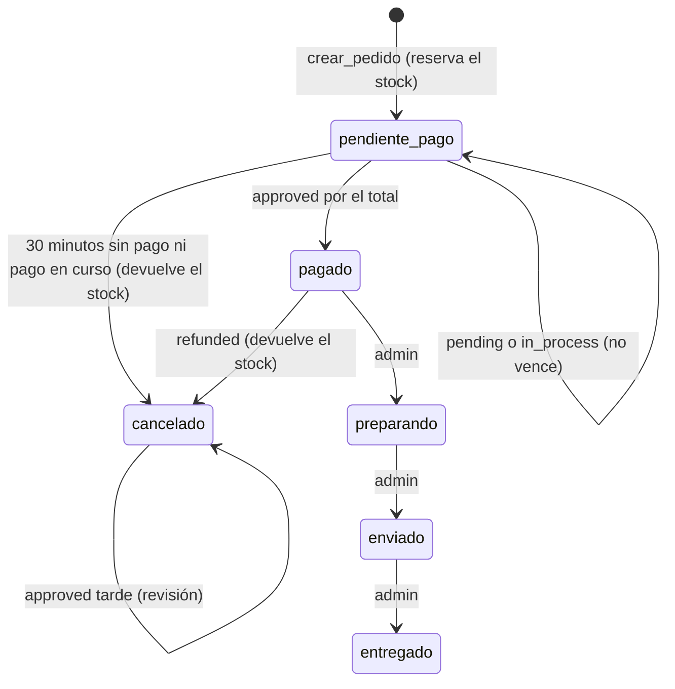

# API de green.

La tienda no depende de esta API: las páginas leen de Supabase en el servidor y
las mutaciones van por Server Actions (`lib/carrito.js`, `lib/checkout.js`,
`lib/cuenta.js`). `/api/v1` es la puerta para lo que llega de afuera: el
catálogo, de solo lectura, los pedidos del usuario con sesión y el webhook de
Mercado Pago.

| Método | URL                            | Pide            | Devuelve                                   |
| ------ | ------------------------------ | --------------- | ------------------------------------------ |
| GET    | `/api/v1/productos`            | —               | El catálogo, paginado                      |
| GET    | `/api/v1/productos/[slug]`     | —               | Un producto con su ficha                   |
| GET    | `/api/v1/combos`               | —               | Los combos a la venta                      |
| GET    | `/api/v1/combos/[slug]`        | —               | Un combo, con el precio de cada elección   |
| GET    | `/api/v1/pedidos`              | Sesión          | Los pedidos del usuario                    |
| GET    | `/api/v1/pedidos/[id]`         | Sesión          | Un pedido del usuario                      |
| POST   | `/api/v1/webhooks/mercadopago` | Firma HMAC      | Recibe los avisos de pago de Mercado Pago  |

## Convenciones

- **Base y versión**: `/api/v1`. Un cambio que rompa a quien ya la usa (sacar o
  renombrar un campo, cambiar un tipo) va a `/api/v2`; sumar campos o
  endpoints, no.
- **Recursos**: sustantivos en plural (`/productos`, `/combos`, `/pedidos`), sin
  verbos en la URL: lo que se hace lo dice el método HTTP. El identificador va
  como parámetro de ruta (`/productos/[slug]`); los filtros y la paginación, en
  la query (`?categoria=raquetas&page=2`).
- **JSON**: cuerpos y respuestas en JSON. Una respuesta correcta envuelve el
  recurso con su nombre (`{ "producto": … }`, `{ "productos": […], "paginacion": … }`);
  una con error, en `{ "error": … }`. Los precios son enteros en ARS.
- **Código**: cada endpoint es un Route Handler (`app/api/v1/**/route.js`)
  envuelto en `conErrores` de `lib/api.js`. Los parámetros pasan por un esquema
  de `lib/esquemas.js` con `validar`, y los datos salen de `lib/productos.js`,
  `lib/combos.js` y `lib/pedidos.js`: las mismas funciones que usan las páginas.
- **Métodos y rutas**: un método que la ruta no tiene (`POST /api/v1/productos`)
  lo responde Next con `405 Method Not Allowed`, sin cuerpo. Una ruta que no
  existe bajo `/api/v1` responde `404 ruta_inexistente` en JSON
  (`app/api/v1/[...ruta]/route.js`), no la página HTML de Next.
- **Caché**: todo se lee en cada request (el stock cambia). Los pedidos salen,
  además, con `Cache-Control: private, no-store`.

### Errores

Todos con la misma forma, armada por el helper de `lib/api.js`:

```json
{
  "error": {
    "codigo": "datos_invalidos",
    "mensaje": "Los datos no tienen el formato esperado.",
    "detalles": [{ "campo": "page", "mensaje": "Tiene que ser un número entero del 1 al 1000." }]
  }
}
```

- **`ErrorApi(status, codigo, mensaje, detalles)`** es un error esperado: sale
  con su status y su código. `noEncontrado(mensaje)` y `sinSesion()` arman los
  de siempre, y `validar(esquema, datos)` tira el 400 con `detalles`: uno por
  cada campo que no pasó (Zod no corta en el primero). `detalles` aparece solo
  en ese caso.
- **`conErrores(manejador)`** envuelve cada handler: atrapa lo que tire, lo
  registra en el log del servidor y responde el JSON. Un `ErrorApi` 4xx deja
  una línea de aviso (`GET /api/v1/productos/x → 404 no_encontrado`); uno 5xx,
  la misma línea como error. Cualquier otra excepción es un error nuestro: se
  loguea completa, con el stack, y responde `500 error_interno` sin contar
  nada más. **El stack nunca sale en la respuesta.**
- Los errores internos de Next (`notFound()`, `redirect()`) no se atrapan:
  `unstable_rethrow` los deja seguir.

| Código                      | Status | Cuándo                                                              |
| --------------------------- | ------ | ------------------------------------------------------------------- |
| `datos_invalidos`           | 400    | La query, los parámetros de ruta o el cuerpo no pasan el esquema    |
| `sin_sesion`                | 401    | El endpoint pide sesión y no hay (o venció y no se pudo renovar)    |
| `firma_invalida`            | 401    | Webhook: falta `x-signature` o no coincide                          |
| `sin_permiso`               | 403    | Hay sesión pero no alcanza. Reservado: hoy ningún endpoint lo usa (ver «Por qué un pedido ajeno da 404») |
| `no_encontrado`             | 404    | El recurso no existe, o no es del usuario                           |
| `ruta_inexistente`          | 404    | No hay ningún endpoint en esa ruta                                  |
| —                           | 405    | El método no existe en esa ruta (lo responde Next, sin cuerpo)      |
| `error_interno`             | 500    | Un error nuestro (falta una variable, falló la base…)               |
| `mercadopago_no_responde`   | 502    | Webhook: Mercado Pago no respondió o respondió con error            |
| `pago_online_no_disponible` | 503    | Webhook: falta configurar Mercado Pago (ver «Sin configurar»)       |

## Por qué Zod

[Zod](https://zod.dev) ya estaba en el proyecto (lo sumó el webhook de Mercado
Pago) y ahora valida **todas** las entradas del servidor: la API, las Server
Actions y el webhook. Frente a validar a mano, como se hacía antes
(`limpiarEnvio`, un regex de email, `problemaContrasena`, cada uno con su
estilo):

- **El esquema es el contrato.** `lib/esquemas.js` dice en un lugar qué entra y
  con qué reglas; el código que lo usa recibe datos ya validados.
- **Errores por campo.** `safeParse` no corta en el primer problema: devuelve
  todos, cada uno con su campo (`path`) y su mensaje. Es lo que necesita un 400
  con `detalles`, y lo que el checkout junta en «Faltan datos: …».
- **Convierte además de validar.** `z.coerce.number()` pasa el `"2"` de la query
  a `2`; `.trim()`, `.toLowerCase()` y `.overwrite()` normalizan el email y el
  código postal; `.default()` completa `page` y `limit`. Lo que sale del esquema
  ya está limpio.
- **Mensajes en castellano** en cada regla, sin un diccionario aparte.
- **Costo bajo.** Una dependencia sin dependencias propias, y solo en el
  servidor: `lib/esquemas.js` importa `server-only`, así que si un componente
  del navegador lo importara, el build fallaría. Al navegador llegan 0 KB.

Alternativas: Valibot (más chico, pero en el servidor el tamaño casi no
importa) o JSON Schema con Ajv (más verboso, pensado para contratos entre
lenguajes). El navegador sigue validando con atributos HTML (`required`,
`maxLength`, `type="email"`), pero eso es para avisar antes: la validación que
cuenta es la del servidor.

## Catálogo

Público: no pide sesión. Lee con la clave publicable, y RLS deja ver solo lo
activo.

### `GET /api/v1/productos`

Los productos a la venta, en el orden de la tienda, de a una página.

| Parámetro (query) | Tipo   | Por defecto | Reglas                                            |
| ----------------- | ------ | ----------- | ------------------------------------------------- |
| `categoria`       | texto  | todas       | `raquetas`, `pelotas`, `cuerdas-y-grips` o `bolsos` |
| `page`            | entero | `1`         | De 1 a 1000                                       |
| `limit`           | entero | `12`        | De 1 a 48                                         |

Los parámetros que no son estos se ignoran. La paginación la hace la base:
`.range()` pasa el offset y el limit a la consulta y `count: "exact"` trae el
total, así que no se leen todos los productos para devolver doce. Una página
después de la última responde 200 con la lista vacía.

```
curl "https://<dominio>/api/v1/productos?categoria=pelotas&limit=1"
```

**200**

```json
{
  "productos": [
    {
      "id": 6,
      "slug": "head-tour-xt",
      "categoria": "pelotas",
      "tipo": "pelota",
      "marca": "Head",
      "nombre": "Tour XT",
      "descripcion": "Pelota presurizada para todas las superficies, con pique parejo.",
      "destacado": true,
      "precioBase": 18900,
      "variantes": [
        { "id": 20, "nombre": "Tubo x3", "precio": 18900, "stock": 60 },
        { "id": 21, "nombre": "Pack x6 tubos", "precio": 108000, "stock": 12 },
        { "id": 22, "nombre": "Caja x24 tubos", "precio": 399000, "stock": 3 }
      ],
      "fotos": ["https://<proyecto>.supabase.co/storage/v1/object/public/productos/estudio/head-tour-xt-1.webp"]
    }
  ],
  "paginacion": { "page": 1, "limit": 1, "total": 5, "paginas": 5 }
}
```

`precioBase` es el de la variante más barata («desde»). `stock: null` quiere
decir que no se controla.

**400** (`?categoria=zapatillas&page=0&limit=abc`)

```json
{
  "error": {
    "codigo": "datos_invalidos",
    "mensaje": "Los datos no tienen el formato esperado.",
    "detalles": [
      { "campo": "categoria", "mensaje": "Tiene que ser una de estas: raquetas, pelotas, cuerdas-y-grips, bolsos." },
      { "campo": "page", "mensaje": "Tiene que ser un número entero del 1 al 1000." },
      { "campo": "limit", "mensaje": "Tiene que ser un número entero del 1 al 48." }
    ]
  }
}
```

| Status | Cuándo                                     |
| ------ | ------------------------------------------ |
| 200    | Siempre que la query sea válida            |
| 400    | `categoria`, `page` o `limit` no pasan      |
| 500    | Falló la base                              |

### `GET /api/v1/productos/[slug]`

Un producto, con sus variantes y su ficha técnica.

| Parámetro (ruta) | Reglas                                                        |
| ---------------- | ------------------------------------------------------------- |
| `slug`           | Minúsculas, números y guiones (`babolat-pure-drive`); hasta 120 caracteres |

```
curl "https://<dominio>/api/v1/productos/wilson-blade-98"
```

**200**: lo mismo que un ítem de la lista, más `ficha`. Para raquetas y cuerdas
es un objeto con campos fijos; para lo demás, una lista de pares
`[rótulo, valor]` o `null`.

```json
{
  "producto": {
    "id": 2,
    "slug": "wilson-blade-98",
    "categoria": "raquetas",
    "tipo": "raqueta",
    "marca": "Wilson",
    "nombre": "Blade 98",
    "descripcion": "Raqueta de control, con cabeza de 98 pulgadas. Para jugadores con un swing completo.",
    "destacado": false,
    "precioBase": 405000,
    "variantes": [
      { "id": 6, "nombre": "Grip 2 / 305 g", "precio": 405000, "stock": 3, "grip": 2, "pesoG": 305 }
    ],
    "fotos": [],
    "ficha": {
      "cabezaPulg2": 98,
      "largoMm": 685,
      "balanceMm": 320,
      "patron": [16, 19],
      "rigidezRa": null,
      "tensionKg": [23, 27]
    }
  }
}
```

**404**

```json
{ "error": { "codigo": "no_encontrado", "mensaje": "No hay ningún producto con ese slug." } }
```

| Status | Cuándo                                                  |
| ------ | ------------------------------------------------------- |
| 200    | El producto existe y está a la venta                    |
| 400    | El slug no tiene el formato (`/productos/Mal_Slug`)     |
| 404    | No hay ningún producto activo con ese slug              |
| 500    | Falló la base                                           |

### `GET /api/v1/combos`

Los combos a la venta, en el orden de la tienda. No tiene parámetros: son
pocos. Un combo con algún ítem que ya no se vende no aparece.

```
curl "https://<dominio>/api/v1/combos"
```

**200**: `{ "combos": [ … ] }`, cada uno con la misma forma que en el detalle.

| Status | Cuándo        |
| ------ | ------------- |
| 200    | Siempre       |
| 500    | Falló la base |

### `GET /api/v1/combos/[slug]`

Un combo con sus ítems y el precio de cada elección posible.

| Parámetro (ruta) | Reglas                            |
| ---------------- | --------------------------------- |
| `slug`           | Igual que en `/productos/[slug]`  |

```
curl "https://<dominio>/api/v1/combos/kit-para-arrancar"
```

**200**

```json
{
  "combo": {
    "id": 1,
    "slug": "kit-para-arrancar",
    "nombre": "Kit para arrancar",
    "descripcion": "Raqueta, un tubo de pelotas y overgrips para empezar a jugar.",
    "descuentoPct": 10,
    "destacado": false,
    "precioListaDesde": 400800,
    "precioDesde": 360720,
    "stock": 10,
    "fotos": [],
    "items": [
      {
        "id": 1,
        "cantidad": 1,
        "elige": true,
        "producto": { "slug": "yonex-ezone-100", "categoria": "raquetas", "marca": "Yonex", "nombre": "Ezone 100", "fotos": [] },
        "variantes": [
          { "id": 13, "nombre": "Grip 1 / 300 g", "precio": 379000, "stock": 1 },
          { "id": 14, "nombre": "Grip 2 / 300 g", "precio": 379000, "stock": 4 }
        ]
      },
      {
        "id": 2,
        "cantidad": 1,
        "elige": false,
        "producto": { "slug": "head-tour-xt", "categoria": "pelotas", "marca": "Head", "nombre": "Tour XT", "fotos": [] },
        "variantes": [{ "id": 20, "nombre": "Tubo x3", "precio": 18900, "stock": 60 }]
      },
      {
        "id": 3,
        "cantidad": 1,
        "elige": false,
        "producto": { "slug": "wilson-pro-overgrip", "categoria": "cuerdas-y-grips", "marca": "Wilson", "nombre": "Pro Overgrip", "fotos": [] },
        "variantes": [{ "id": 39, "nombre": "Pack x3", "precio": 12900, "stock": 40 }]
      }
    ],
    "precios": {
      "13": { "lista": 410800, "descuento": 41080, "precio": 369720 },
      "14": { "lista": 410800, "descuento": 41080, "precio": 369720 }
    }
  }
}
```

- `elige: true`: el comprador elige la variante (en el ejemplo, el grip); si no,
  va la única que trae.
- `precios`: el precio de cada elección. La clave son los ids de las variantes
  elegidas en los ítems con `elige: true`, en orden y separados por comas (`""`
  si no hay nada para elegir). El descuento se redondea para abajo, con la
  misma cuenta que `crear_pedido`.
- `stock`: cuántos combos alcanzan con el stock de hoy (`null`: sin límite).

| Status | Cuándo                                         |
| ------ | ---------------------------------------------- |
| 200    | El combo existe y todos sus ítems se venden    |
| 400    | El slug no tiene el formato                    |
| 404    | No hay ningún combo a la venta con ese slug    |
| 500    | Falló la base                                  |

## Pedidos

Los pedidos del usuario con sesión. Son de solo lectura: se crean desde el
checkout (`confirmarPedido`).

### Autenticación

Con la cookie de sesión de Supabase, la misma del sitio (`sb-<proyecto>-auth-token`,
que se escribe al ingresar en `/ingresar`). No hay tokens aparte. El handler
pide el usuario con `getUsuario()` (`lib/sesion.js`), que lo verifica contra
Supabase Auth: no alcanza con que la cookie exista. Si el access token venció,
lo renueva con el refresh token y escribe las cookies nuevas en la respuesta.
El proxy (`proxy.js`) no corre en `/api` y no hace falta.

Los dos endpoints controlan en este orden:

1. **La sesión.** Si no hay, `401 sin_sesion`. Va primero: sin sesión no se
   mira nada más, ni el formato del id.
2. **Los parámetros**, con su esquema. Si no pasan, `400 datos_invalidos`.
3. **La consulta**, con el cliente con sesión. RLS (la política «dueño o admin»
   de `pedidos`, `pedido_items` y `pedido_combos`) deja ver solo los pedidos
   del usuario: el handler no filtra por usuario a mano. Si no aparece, `404`.

Para probarlos, con la sesión iniciada en el navegador, desde la consola de
una página del sitio: `await (await fetch("/api/v1/pedidos")).json()`. Con curl
hay que pasar la cookie (`curl -b "sb-…-auth-token=…"`).

### `GET /api/v1/pedidos`

Los pedidos del usuario, el más nuevo primero. Sin parámetros.

```
curl -b "sb-<proyecto>-auth-token=…" "https://<dominio>/api/v1/pedidos"
```

**200**

```json
{
  "pedidos": [
    {
      "id": "0b6f5c9e-2f4d-4a51-9f0e-6d7c1a2b3c4d",
      "numero": 42,
      "total": 369720,
      "creadoEn": "2026-10-22T17:30:00.123456+00:00",
      "estado": { "clave": "pagado", "texto": "Pagado" }
    }
  ]
}
```

`estado.clave` es el estado del pedido, más dos que calcula la tienda:
`procesando` (pendiente, con un pago en curso en Mercado Pago) y `vencido`
(pendiente, pasados los 30 minutos).

**401**

```json
{ "error": { "codigo": "sin_sesion", "mensaje": "Hace falta iniciar sesión." } }
```

| Status | Cuándo                                    |
| ------ | ----------------------------------------- |
| 200    | Hay sesión (la lista puede venir vacía)   |
| 401    | Sin sesión                                |
| 500    | Falló la base                             |

### `GET /api/v1/pedidos/[id]`

Un pedido del usuario, con sus líneas, sus totales y los datos de envío.

| Parámetro (ruta) | Reglas                                                    |
| ---------------- | --------------------------------------------------------- |
| `id`             | Un uuid (`0b6f5c9e-2f4d-4a51-9f0e-6d7c1a2b3c4d`)          |

```
curl -b "sb-<proyecto>-auth-token=…" "https://<dominio>/api/v1/pedidos/0b6f5c9e-2f4d-4a51-9f0e-6d7c1a2b3c4d"
```

**200**

```json
{
  "pedido": {
    "id": "0b6f5c9e-2f4d-4a51-9f0e-6d7c1a2b3c4d",
    "numero": 42,
    "email": "comprador@ejemplo.com",
    "creadoEn": "2026-10-22T17:30:00.123456+00:00",
    "estado": { "clave": "pagado", "texto": "Pagado" },
    "venceEn": "2026-10-22T18:00:00.123Z",
    "canceladoPor": null,
    "initPoint": "https://www.mercadopago.com.ar/checkout/v1/redirect?pref_id=…",
    "ultimoPago": "approved",
    "pagoTrasCancelar": false,
    "lista": 410800,
    "descuento": 41080,
    "envio": 0,
    "total": 369720,
    "envioDatos": {
      "nombre": "Ana Pérez",
      "telefono": "11 4444-5555",
      "calle": "Av. Corrientes 1234",
      "piso": "",
      "ciudad": "CABA",
      "provincia": "Ciudad Autónoma de Buenos Aires",
      "codigoPostal": "C1043AAZ"
    },
    "combos": [
      {
        "id": "5d0e…",
        "comboId": 1,
        "nombre": "Kit para arrancar",
        "descuentoPct": 10,
        "lista": 410800,
        "descuento": 41080,
        "precio": 369720,
        "lineas": [
          {
            "id": "9a1c…",
            "slug": "yonex-ezone-100",
            "href": "/producto/yonex-ezone-100",
            "nombre": "Yonex Ezone 100",
            "variante": "Grip 2 / 300 g",
            "precioUnitario": 379000,
            "cantidad": 1,
            "subtotal": 379000
          }
        ]
      }
    ],
    "sueltas": []
  }
}
```

Los precios y los nombres son los que quedaron copiados al comprar, aunque el
catálogo haya cambiado después.

**400** (`/pedidos/abc`, con sesión)

```json
{
  "error": {
    "codigo": "datos_invalidos",
    "mensaje": "Los datos no tienen el formato esperado.",
    "detalles": [{ "campo": "id", "mensaje": "Tiene que ser un uuid." }]
  }
}
```

**404**

```json
{ "error": { "codigo": "no_encontrado", "mensaje": "No hay ningún pedido tuyo con ese id." } }
```

| Status | Cuándo                                                        |
| ------ | ------------------------------------------------------------- |
| 200    | El pedido es del usuario (un admin ve todos: lo dice la política) |
| 400    | Hay sesión y el id no es un uuid                              |
| 401    | Sin sesión, con cualquier id                                  |
| 404    | El pedido no existe **o es de otro usuario**                  |
| 500    | Falló la base                                                 |

### Por qué un pedido ajeno da 404 y no 403

Un 403 («existe, pero no podés verlo») le confirma a quien pregunta que ese id
es un pedido real de otra persona. Eso ya es una fuga: permite saber qué ids
existen (enumerarlos) y armar ataques sobre esa base. Con un 404, «no existe» y
«no es tuyo» son indistinguibles desde afuera. Es el mismo criterio de GitHub:
un repositorio privado ajeno da 404, no 403.

Además, con RLS es la respuesta honesta: la consulta corre con la sesión del
usuario y la base ni siquiera devuelve la fila. El handler no sabe si el
pedido existe; sabe que para ese usuario no está. Para dar un 403 habría que
consultar con la service role, salteando RLS, solo para contar algo que
conviene callar.

El 403 queda para cuando revelar la existencia no importa y lo que falta es un
permiso: por ejemplo, un endpoint de admin al que entra un usuario común.

## Server Actions

No están bajo `/api/v1`, pero son endpoints igual: Next las publica como `POST`
a la página que las usa, y cualquiera puede llamarlas con cualquier argumento.
Por eso validan con Zod como la API. En vez de un 400, devuelven el error en
castellano para el formulario.

| Acción              | Archivo           | Esquema               | Si no pasa                                                                                   |
| ------------------- | ----------------- | --------------------- | -------------------------------------------------------------------------------------------- |
| `cotizarCarrito`    | `lib/carrito.js`  | `Lineas`              | Lanza un error. El navegador siempre manda líneas limpias, así que solo falla un pedido armado a mano; el carrito muestra «No se pudo calcular el pedido» |
| `confirmarPedido`   | `lib/checkout.js` | `Envio` y `Lineas`    | «Faltan datos: nombre y apellido, teléfono.», «El teléfono no parece válido.», «Elegí una provincia de la lista.», el formato del código postal, o «Algo cambió en tu carrito…» |
| `ingresar`          | `lib/cuenta.js`   | `Ingreso`             | «Escribí tu email y tu contraseña.»                                                          |
| `registrarme`       | `lib/cuenta.js`   | `Registro`            | «Escribí un email válido.», «La contraseña tiene que tener al menos 8 caracteres.» o «Las contraseñas no coinciden.» |
| `cambiarContrasena` | `lib/cuenta.js`   | `ContrasenaNueva`     | Las mismas dos de la contraseña                                                              |
| `pedirRecuperacion` | `lib/cuenta.js`   | `Recuperacion`        | «Escribí un email válido.»                                                                   |

- **`Lineas`**: hasta 30 líneas (`{ tipo: "producto", varianteId, cantidad }` o
  `{ tipo: "combo", comboId, elecciones, cantidad }`), con ids enteros positivos
  y cantidades de 1 a 99. Las repetidas se unen en una. El carrito del
  navegador limpia lo guardado en localStorage con `limpiarLineas`
  (`lib/lineas.js`), con los mismos límites.
- **`Envio`**: los campos de `CAMPOS_ENVIO` (`lib/envio.js`), sin espacios de
  más y con su largo máximo; el código postal, en mayúsculas y sin espacios.
- **Email**: sin espacios de más, en minúsculas y con el mismo criterio que el
  `type="email"` del navegador.

## Seguridad

### Validación en el servidor

Toda entrada pasa por un esquema de Zod antes de usarse: la query y los
parámetros de ruta de la API, los argumentos de las Server Actions y el aviso
del webhook. Lo que no pasa no llega a la base. La validación del navegador
(atributos HTML, el aviso de contraseñas distintas) es solo para avisar antes:
se puede saltear con un `fetch` armado a mano. Los precios, los descuentos y
el stock nunca vienen del navegador: el carrito manda ids y cantidades, y el
servidor (`cotizarCarrito`) y la base (`crear_pedido`) recalculan todo.

### Consultas parametrizadas (inyección SQL)

No hay SQL armado con texto en ningún lado. El código consulta con supabase-js
(`.eq("slug", slug)`, `.in("id", ids)`, `.range(desde, hasta)`), que arma un
pedido HTTP a PostgREST con cada valor como parámetro, codificado en la URL.
PostgREST lo traduce a una consulta preparada, con el valor como parámetro y
no pegado al SQL. Un slug como `'; drop table pedidos; --` es un texto que no
coincide con ningún producto, no una instrucción.

- Ninguna entrada del usuario se interpola en los filtros que se escriben como
  texto (`.or()`, `.filter()`), que sí tienen su propia sintaxis.
- Las funciones de la base (`crear_pedido`, `conciliar_pago`…) reciben sus
  argumentos como `jsonb` y los usan como valores. Ninguna arma SQL dinámico
  con `execute`.
- Además, los esquemas ya rechazan lo que no tiene el formato (un slug con
  comillas da 400 antes de consultar).

### Escape de React (XSS)

Todo lo que viene de la base (nombres, descripciones, datos de envío) se
muestra con JSX, que escapa el texto: un `<script>` en una descripción se ve
como texto y no se ejecuta. El proyecto no usa `dangerouslySetInnerHTML`. La
API responde JSON (`application/json`), que el navegador no interpreta como
HTML.

### RLS (Row Level Security)

Todas las tablas tienen RLS activado, y las políticas deciden qué ve cada uno
aunque el código se equivoque:

- **Catálogo**: lectura pública solo de lo activo. Por eso la clave
  publicable puede estar en el código: con ella no se ve más que lo que muestra
  la tienda, y no se puede escribir.
- **Pedidos**: cada usuario ve los suyos y el admin, todos («dueño o admin»).
  Nadie los escribe directo: solo las funciones.
- **Funciones**: las que escriben con privilegios (`security definer`, con
  `search_path` vacío) tienen el `execute` restringido. `crear_pedido` es solo
  para `authenticated` y toma al usuario de `auth.uid()`, no de un argumento.
  `conciliar_pago`, `guardar_preferencia` y `liberar_pedidos_vencidos` son solo
  para `service_role`, con `SUPABASE_SECRET_KEY`, que nunca sale del servidor.

### Lo demás

- **Errores sin detalles internos**: `conErrores` responde un 500 genérico; el
  stack y el mensaje original quedan solo en el log del servidor.
- **Secretos**: ninguna variable secreta lleva `NEXT_PUBLIC_`, y
  `lib/esquemas.js`, `lib/mercadopago.js`, `lib/cobros.js` y
  `lib/supabaseServicio.js` importan `server-only`.
- **Webhook**: la firma HMAC-SHA256 se compara en tiempo constante (ver abajo).
- **Redirecciones**: `rutaSiguiente` (`lib/siguiente.js`) solo acepta rutas del
  mismo sitio, así que `?siguiente=https://otro.com` no sirve para una
  redirección abierta.
- **Pedidos y cookies**: la API no manda encabezados CORS, así que otro sitio
  no puede leer desde el navegador una respuesta que salió con la cookie del
  usuario. Las cookies de Supabase son `SameSite=Lax`, y los datos personales
  salen con `Cache-Control: private, no-store`, para que ningún caché
  intermedio los guarde.

## `POST /api/v1/webhooks/mercadopago`

Recibe los avisos de Mercado Pago (Webhooks, evento **Pagos**) y concilia cada
pago con su pedido. Es uno de los dos caminos de conciliación; el otro es la
conciliación activa de las páginas del pedido (ver «Dos caminos de
conciliación»). Los dos terminan en la misma función, `conciliar_pago`, con el
pago tal como lo devuelve la API de Mercado Pago.

Código: `app/api/v1/webhooks/mercadopago/route.js`, `lib/mercadopago.js`,
`lib/cobros.js` y la función `conciliar_pago` de
`supabase/migrations/0002_pagos.sql`.

### Qué llega

```
POST /api/v1/webhooks/mercadopago?data.id=123456&type=payment
x-signature: ts=1742505638683,v1=ced36ab6d33566bb1e16c125819b8d840d6b8ef136b0b9127c76064466f5229b
x-request-id: bb56a2f1-6aae-46ac-982e-9dcd3581d08e
User-Agent: MercadoPago WebHook v1.0 payment
Content-Type: application/json

{"action":"payment.updated","api_version":"v1","data":{"id":"123456"},
 "date_created":"2026-10-22T17:32:00Z","id":"123456","live_mode":false,
 "type":"payment","user_id":724484980}
```

Los avisos llegan a la URL registrada en el panel (Webhooks › Configurar
notificaciones). Las preferencias **no** mandan `notification_url`: con ella,
los avisos reales del pedido #4 (que llegaban con `source_news=webhooks`, el
parámetro que la tienda le agregaba) dieron `401 firma_invalida`, mientras
«Simular», que va a la URL del panel, daba 200. La documentación garantiza la
firma para «la URL registrada»; no dice lo mismo de la `notification_url`. Las
preferencias creadas antes del cambio la siguen teniendo: sus avisos llegan
con `source_news=webhooks`, y el log lo muestra.

### Qué hace

1. **Valida la firma.** De `x-signature` saca `ts` y `v1`, y arma el
   manifiesto `id:<data.id>;request-id:<x-request-id>;ts:<ts>;` (con `data.id`
   de la query, en minúsculas; lo que no llega se saca del manifiesto). Calcula
   el HMAC-SHA256 en hexadecimal con cada clave de `MP_WEBHOOK_SECRET` (puede
   traer varias, separadas por comas) y lo compara con `v1` en tiempo
   constante. Si ninguna coincide: **401**, con el motivo en el log (ver
   «Diagnóstico de la firma»). No se rechaza por la antigüedad de `ts`: un
   aviso repetido no hace daño (ver «Idempotencia»).
2. **Mira el tipo** (`type` del cuerpo o de la query). Si no es `payment`,
   responde **200** y no hace nada más.
3. **Valida el id** del pago con Zod (`data.id`, numérico). Si no: **400**.
4. **Consulta el pago** con `GET https://api.mercadopago.com/v1/payments/:id` y
   el Access Token. Del aviso no se usa nada más que el id: el estado, el monto
   y el pedido salen de esta respuesta. Si el pago no existe (el «Simular» del
   panel), responde **200** con `pago_inexistente`.
5. **Concilia** con `conciliar_pago` (ver abajo), llamada con
   `SUPABASE_SECRET_KEY`: es una función `security definer` que solo puede
   ejecutar `service_role`.
6. Responde **200** con lo que hizo.

Todo esto tarda menos de un segundo (las llamadas a Mercado Pago cortan a los
8 s; Mercado Pago espera 22 s). Por eso el pago se procesa **antes** de
responder: si Mercado Pago o la base fallan, el 5xx hace que Mercado Pago
reintente (cada 15 minutos, y después más espaciado). Responder 200 primero y
procesar después perdería el aviso si algo falla.

### Respuestas

| Status | Cuerpo                                            | Cuándo                                         |
| ------ | ------------------------------------------------- | ---------------------------------------------- |
| 200    | `{ "recibido": true, "resultado": "pagado" }`     | Un pago conciliado (ver resultados)            |
| 200    | `{ "recibido": true, "resultado": "ignorado", "tipo": "…" }` | Un evento que no es un pago          |
| 400    | `datos_invalidos`                                 | `data.id` falta o no es numérico               |
| 401    | `firma_invalida`, con el motivo en `detalles`     | La firma no coincide                           |
| 500    | `error_interno`                                   | Falta una variable o falló la base             |
| 502    | `mercadopago_no_responde`                         | No se pudo consultar el pago                   |
| 503    | `pago_online_no_disponible`                       | Falta alguna de las tres variables             |

Resultados (`resultado`): `pagado`, `en_curso`, `rechazado`, `cancelado`,
`revision`, `registrado` (se guardó el estado, sin cambios en el pedido),
`sin_cambios` (el mismo aviso otra vez), `ajeno` (el pago no es de un pedido de
la tienda: un cobro con QR, un link de pago) y `pago_inexistente`.

### Diagnóstico de la firma

Cada 401 deja una línea en el log (Vercel › el proyecto › Logs, buscando
«Webhook de Mercado Pago»), sin las claves ni los hashes:

```
Webhook de Mercado Pago: firma rechazada (hash distinto). data.id=184583338061,
x-request-id=bb56a2f1-…, ts=1792711789068 (en milisegundos, hace 1 s),
claves probadas=2, live_mode=false, source_news=webhooks,
user-agent="MercadoPago WebHook v1.0 payment"
```

El motivo es uno de estos:

| Motivo                              | Qué quiere decir                                                            |
| ----------------------------------- | --------------------------------------------------------------------------- |
| `falta x-signature`                 | El aviso no vino firmado                                                    |
| `x-signature sin ts o sin v1`       | El header vino, pero no con la forma `ts=…,v1=…`                            |
| `hash distinto, sin x-request-id`   | No vino `x-request-id`: el manifiesto queda sin esa parte y no coincide     |
| `hash distinto`                     | Vino todo, pero ninguna clave da el mismo HMAC: no es la clave que firma    |

La respuesta lleva el mismo motivo en `detalles`, así que también se ve en el
historial de notificaciones del panel de Mercado Pago. Un aviso que pasa deja
`pago 184583338061 → pagado (firma válida con la clave 2 de 2,
live_mode=false, source_news=no vino)`: con las dos claves cargadas, dice cuál
firma.

- **El `ts`**: el log dice si vino en milisegundos (13 dígitos, como lo manda
  Mercado Pago) o en segundos, y cuánto hace. No se rechaza por antigüedad:
  el SDK oficial, con su tolerancia prendida, lo multiplica por 1000 como si
  fueran segundos y rechazaría todo aviso en milisegundos.
- **Con credenciales de prueba**: las credenciales de prueba son las de la
  cuenta de prueba vendedora, que para Mercado Pago es una cuenta más: sus
  pagos llegan con `live_mode=true` y se firman con la clave del webhook de
  **esa cuenta**, no con la de tu panel. Mercado Pago lo indica en la guía de
  notificaciones de QR: con credenciales de prueba, ingresar a Mercado Pago
  Developers con el usuario y la contraseña de la cuenta de prueba vendedora y
  configurar los Webhooks en su modo productivo. Por eso «Simular» (firmado
  con la clave de tu panel) pasa y los avisos de las compras de prueba dan
  `hash distinto`. Ver «Puesta en marcha › Mercado Pago».

### Dos caminos de conciliación

Un pedido se entera de sus pagos por dos caminos, que terminan igual:

1. **El webhook** (Mercado Pago avisa): con la firma válida, consulta el pago
   avisado con `GET /v1/payments/:id` y lo concilia. Es estricto: con la firma
   inválida responde 401 y no consulta ni concilia nada.
2. **La conciliación activa** (la tienda pregunta): cuando el comprador vuelve
   por las `back_urls` (`/mis-pedidos/[id]/pago/…`) y cuando abre
   `/mis-pedidos/[id]`, si el pedido está en `pendiente_pago` (también «Pago
   en proceso» y «Vencido», que en la base siguen pendientes), el servidor
   busca sus pagos con
   `GET /v1/payments/search?external_reference=<id del pedido>&sort=date_created&criteria=asc`
   y concilia cada uno, del más viejo al más nuevo (`conciliarPedido` en
   `lib/cobros.js`). Si Mercado Pago no responde, la página se muestra con lo
   que hay y queda en el log. No depende del webhook ni de su firma: un pago
   se acredita aunque el aviso no llegue o no valide.

En los dos, `conciliar_pago` aplica las mismas validaciones (que el pedido
exista, que el estado pueda pasar, que el monto sea el total en ARS) y es
idempotente, así que no importa cuál llegue primero ni si los dos concilian el
mismo pago: el segundo da `sin_cambios`.

**Por qué la API es la fuente de verdad.** Lo que llega de afuera puede estar
falsificado, repetido o viejo: el cuerpo del aviso y, sobre todo, los
parámetros con los que vuelve el comprador (`?status=approved&payment_id=…`),
que cualquiera puede escribir en la barra del navegador. La API, en cambio,
responde con el Access Token de la tienda, así que solo devuelve pagos
cobrados por la tienda, y con su estado de ahora. Por eso ningún camino usa el
cuerpo del aviso más que como señal ni los parámetros de la URL de vuelta para
nada: el pedido sale de la ruta (`/mis-pedidos/[id]`, que con RLS solo
encuentra los del usuario) y los pagos, de Mercado Pago. Un resultado de la
búsqueda con otro `external_reference` se descarta.

La búsqueda puede tardar unos segundos en mostrar un pago recién hecho: si el
comprador vuelve antes, «Pago aprobado» dice que en unos segundos se ve
acreditado, y la próxima vez que abra el pedido se concilia. Cada página de un
pedido pendiente hace una consulta a Mercado Pago; un pedido pagado, ninguna.

### La conciliación

`conciliar_pago(pago jsonb)` busca el pedido por `external_reference` (que es el
id del pedido), lo bloquea y registra el pago en `pagos`. Después, según el
estado del pago:

| Estado en Mercado Pago            | El pedido                                                                                  |
| --------------------------------- | ------------------------------------------------------------------------------------------ |
| `approved`                        | Pendiente y el monto es el total en ARS → **pagado**. Si no, revisión (ver abajo)           |
| `pending`, `in_process`, `authorized` | Sigue pendiente y **no vence** mientras tanto (`pago_en_curso`)                        |
| `rejected`, `cancelled`           | Sigue pendiente: se puede **reintentar** hasta que venza                                    |
| `refunded`                        | Si es el pago que lo pagó: **cancelado** y el stock vuelve. Si ya se envió: revisión         |
| `charged_back`                    | Revisión                                                                                   |
| otro (`in_mediation`…)            | Solo se registra                                                                           |

- **El monto**: `transaction_amount` tiene que ser exactamente el `total` del
  pedido, y `currency_id`, `ARS`. Los ítems de la preferencia salen del pedido
  guardado y suman el total, así que una diferencia no debería pasar nunca: si
  pasa, el pedido no se marca pagado.
- **Pagado después de los 30 minutos**: si llega un `approved` y el pedido
  sigue pendiente (nadie lo canceló todavía), se marca pagado. El stock sigue
  reservado, así que no hay problema.
- Al final, `conciliar_pago` llama a `liberar_pedidos_vencidos`: un aviso
  también sirve para devolver el stock de los pedidos vencidos.

### Idempotencia y orden

- Con el pedido bloqueado (`for update`), si el pago ya está en `pagos` con el
  mismo estado y detalle, devuelve `sin_cambios` sin escribir nada. Dos avisos
  iguales que llegan a la vez pasan de a uno: el segundo ve lo que dejó el
  primero.
- Las transiciones dependen del estado del pedido (un `approved` solo paga un
  pedido pendiente; un `refunded` solo cancela el pedido que pagó ese pago),
  así que repetir un aviso no repite el efecto: el stock nunca vuelve dos
  veces.
- Como el pago se consulta en el momento, un aviso viejo trae el estado de hoy.
  Si los avisos llegan desordenados (`refunded` antes que `approved`), el
  primero ya concilia el estado final y el otro da `sin_cambios`.
- `pago_en_curso` está en la fila del pedido, no solo en `pagos`: si
  `liberar_pedidos_vencidos` estaba esperando el lock, al volver a evaluar la
  fila lo ve y no la cancela.

### Revisión: lo que no se resuelve solo

Propuesta: una tabla `pedido_revisiones` (una fila por pago y motivo, con
`unique (pago_id, motivo)` para que un aviso repetido no la duplique). El
pedido no se toca: la tienda decide. Motivos:

| Motivo                  | Qué pasó                                                       | Qué hacer                                                                   |
| ----------------------- | -------------------------------------------------------------- | --------------------------------------------------------------------------- |
| `pago_en_cancelado`     | Llegó un `approved` de un pedido ya cancelado (casi siempre, por vencido) | Si hay stock, reactivar el pedido y descontarlo; si no, devolver el pago desde Mercado Pago |
| `pago_duplicado`        | Un segundo `approved` de un pedido ya pagado                    | Devolver uno de los dos                                                      |
| `monto_distinto`        | El `approved` no es el total en ARS                             | Revisar y devolver                                                           |
| `devolucion_tras_envio` | Se devolvió el pago de un pedido ya enviado                     | El stock no vuelve solo: la mercadería no está en el depósito                 |
| `contracargo`           | El comprador desconoció el pago con la tarjeta                  | Responder la disputa en Mercado Pago                                         |

Con `pago_en_cancelado`, el pedido queda cancelado y el stock no se vuelve a
descontar solo, porque ya pudo venderse. El cliente, en su pedido, lee que
Mercado Pago aprobó un pago cuando el pedido ya estaba cancelado y que se está
revisando. Es poco probable: la preferencia vence junto con el pedido, así que
Mercado Pago no acepta pagos después; queda la carrera de un pago aprobado
justo al límite, o uno que estuvo en proceso y se aprobó tarde.

Hasta que haya panel de admin, se miran en el SQL Editor:

```sql
-- Las pendientes
select r.id, r.motivo, r.creada_en, p.numero, p.estado, p.email, g.id as pago, g.monto
from pedido_revisiones r
join pedidos p on p.id = r.pedido_id
join pagos g on g.id = r.pago_id
where r.resuelta_en is null
order by r.creada_en;

-- Resolver una
update pedido_revisiones
set resuelta_en = now(), nota = 'Devuelto desde Mercado Pago'
where id = 1;
```

Cuando haya admin, un aviso por mail al crear una revisión sería lo siguiente.

## El flujo de pago completo



Los estados del pedido en todo esto:



## Por qué el stock se reserva al crear el pedido y no al pagar

`crear_pedido` descuenta el stock en el momento (con las variantes
bloqueadas) y lo devuelve si el pedido vence a los 30 minutos sin pago. Se
podría esperar al `approved`, pero:

- **Checkout Pro pasa afuera de la tienda.** Entre que se crea la preferencia
  y llega el aviso pasan minutos. Si el stock se descontara recién al pagar,
  dos compradores podrían pagar la última raqueta: al segundo se le cobra algo
  que no hay, y hay que devolverle la plata (con su comisión y su mala
  experiencia). Con la reserva, gana quien confirma primero y nadie paga lo
  que no existe.
- **El webhook no es instantáneo ni seguro.** Puede tardar, reintentarse o
  llegar desordenado. Con la reserva, la disponibilidad no depende de cuándo
  llegue el aviso: el aviso solo cambia el estado del pedido.
- **Los pagos en proceso necesitan stock apartado.** Un `in_process` puede
  aprobarse horas después. Si el stock no estuviera reservado, el `approved`
  caería sobre un pedido que ya no se puede cumplir.
- **El precio queda fijo.** El pedido copia precios y descuentos al crearse, y
  la preferencia sale de ahí: lo que cobra Mercado Pago es exactamente el total
  del pedido, aunque el precio del catálogo cambie mientras se paga.

El costo es stock apartado por pedidos que nunca se pagan. Lo acota el
vencimiento: la preferencia vence a los 30 minutos (Mercado Pago no acepta
pagos después) y `liberar_pedidos_vencidos` devuelve el stock. No hay cron: la
llaman `crear_pedido` y cada aviso del webhook, y el sitio ya muestra «Vencido»
apenas pasan los 30 minutos. Si hiciera falta que el stock vuelva justo a
tiempo, se puede programar con `pg_cron` cada pocos minutos.

## Variables de entorno

Todas solo del servidor: **ninguna lleva `NEXT_PUBLIC_`**, así que nunca llegan
al navegador. `lib/mercadopago.js`, `lib/supabaseServicio.js` y
`lib/cobros.js` importan `server-only`.

| Variable               | Para qué                                                    | De dónde sale                                                                                   |
| ---------------------- | ----------------------------------------------------------- | ----------------------------------------------------------------------------------------------- |
| `MP_ACCESS_TOKEN`      | Crear preferencias y consultar pagos                        | Mercado Pago › Tus integraciones › la aplicación › Credenciales de prueba (después, de producción) |
| `MP_WEBHOOK_SECRET`    | Validar la firma de los avisos. Puede traer varias claves separadas por comas (la de prueba y la productiva) | Mercado Pago › la aplicación › Webhooks › Configurar notificaciones › la clave secreta de cada pestaña |
| `SUPABASE_SECRET_KEY`  | Llamar a `conciliar_pago` y `guardar_preferencia`           | Supabase › Project Settings › API Keys › Secret keys (`sb_secret_…`)                             |

Las de Supabase que ya estaban (`NEXT_PUBLIC_SUPABASE_URL` y
`NEXT_PUBLIC_SUPABASE_PUBLISHABLE_KEY`) siguen igual.

### Sin configurar

El pago online se prende solo cuando están **las tres** variables
(`pagoOnlineDisponible()` en `lib/cobros.js`). Con una sola faltante no
alcanza: sin el Access Token no hay preferencia, y sin el secret o la clave de
Supabase se cobraría sin poder marcar el pedido como pagado. Mientras falte
alguna:

- **El checkout** dice «Confirmar pedido» (no «Confirmar y pagar») y, debajo,
  que el pago online todavía no está disponible. El pedido se crea igual con
  `crear_pedido`, en `pendiente_pago` y con el stock reservado, y se va a
  `/mis-pedidos/[id]`.
- **El pedido** muestra arriba «El pago online todavía no está disponible.» y
  hasta qué hora está pendiente, sin botón de pago. Vence igual a los 30
  minutos.
- **Las vueltas** (`/pago/rechazado`) no ofrecen «Probar de nuevo», y
  `pagarPedido` responde con el mismo aviso si alguien la llama igual.
- **El webhook** responde `503 pago_online_no_disponible` sin consultar nada.
  Si llega un aviso con la configuración a medias, Mercado Pago lo reintenta y
  se concilia cuando estén las variables.

Las variables se leen en cada request: para prenderlo alcanza con cargarlas
en Vercel y volver a publicar (Deployments › Redeploy), sin tocar código.

## Puesta en marcha

### Supabase

1. Correr `supabase/migrations/0002_pagos.sql` entero en el SQL Editor,
   **antes** de publicar el código que la usa (la migración es compatible con
   el código anterior).
2. Copiar una Secret key a `SUPABASE_SECRET_KEY`.

### Mercado Pago

1. **La aplicación**: en [Tus integraciones](https://www.mercadopago.com.ar/developers/panel/app),
   «Crear aplicación» › Checkout Pro › API de Preferencias, con un nombre
   («green.»). Al crearla, Mercado Pago crea solo una cuenta de prueba
   vendedora y una compradora.
2. **Credenciales de prueba**: en la aplicación, «Credenciales de prueba» › el
   Access Token (empieza con `APP_USR-`, como el de producción) va a
   `MP_ACCESS_TOKEN`.
3. **El webhook**: en la aplicación, Webhooks › Configurar notificaciones. En
   las dos pestañas (modo de prueba y modo productivo), la URL
   `https://<dominio de producción>/api/v1/webhooks/mercadopago` (sin
   parámetros) y el evento **Pagos**. Es la única URL de avisos: las
   preferencias no mandan `notification_url`. Guardar genera la clave secreta:
   «Revelar» en cada pestaña. Si son distintas, cargar las dos en
   `MP_WEBHOOK_SECRET`, separadas por una coma (`clave_prueba,clave_productiva`).
   **Mientras se use credenciales de prueba**, hace falta además el webhook de
   la cuenta de prueba vendedora: en una ventana de incógnito, ingresar a
   [Mercado Pago Developers](https://www.mercadopago.com.ar/developers) con el
   usuario y la contraseña de la vendedora (la aplicación › Cuentas de prueba;
   si pide un código, son los 6 dígitos que figuran ahí), ir a Tus
   integraciones (crear una aplicación de Checkout Pro si no tiene), Webhooks ›
   Configurar notificaciones › **Modo productivo**, la misma URL y el evento
   Pagos. Guardar, revelar esa clave y sumarla a `MP_WEBHOOK_SECRET`
   (`clave_de_tu_panel,clave_de_la_vendedora`). Al pasar a producción con tus
   credenciales, alcanza la de tu panel.
4. **Probarlo**: «Simular» en esa misma pantalla, con cualquier Data ID, tiene
   que responder 200 con `"resultado": "pago_inexistente"`. Con el id de un
   pago real, lo concilia de verdad: el webhook nunca usa el cuerpo del aviso,
   consulta el pago a Mercado Pago. Sirve para conciliar un pago cuyo aviso se
   perdió.

### Una compra de prueba

En una ventana de incógnito, entrar a la tienda (la de Vercel, no
localhost), comprar y, en Checkout Pro, ingresar con la **cuenta de prueba
compradora** (usuario y contraseña en la aplicación › Cuentas de prueba; si
pide un código por mail, son los 6 dígitos que figuran ahí). Nunca con una
cuenta real: mezclar una cuenta real con credenciales de prueba falla.

Tarjeta: Mastercard `5031 7557 3453 0604`, código `123`, vencimiento `11/30`,
DNI `12345678`. El nombre del titular elige el resultado: `APRO` aprobado,
`OTHE` rechazado, `CONT` pendiente (más en la documentación de Mercado Pago).

### En local

`npm run dev` sirve para todo menos el aviso: las `back_urls` vuelven a
`http://localhost:3000` (sin `auto_return`, que la tienda solo pide con
HTTPS: hay que tocar «Volver al sitio»), pero Mercado Pago no puede avisarle a
localhost, así que el pedido queda pendiente. Para probar el webhook en local,
abrir el sitio por un túnel HTTPS (cloudflared, ngrok) y poner la URL del túnel
en la pestaña de modo de prueba del panel mientras dure la prueba.

### Pasar a producción

Activar las credenciales de producción de la aplicación (pide los datos del
negocio), cambiar `MP_ACCESS_TOKEN` en Vercel por el Access Token de
producción y volver a publicar. El webhook y su secret son los de la misma
aplicación.

### Vercel

En Settings › Environment Variables, cargar `MP_ACCESS_TOKEN`,
`MP_WEBHOOK_SECRET` y `SUPABASE_SECRET_KEY` (marcadas como Sensitive) para
Production y, si se prueba en previews, para Preview. Las previews con
Deployment Protection responden 401 a Mercado Pago: el webhook se prueba en
producción. Después de cargarlas, volver a publicar.
