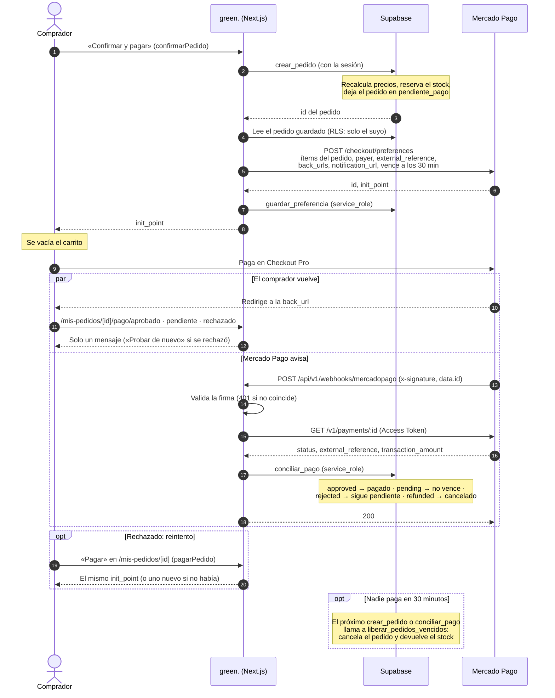
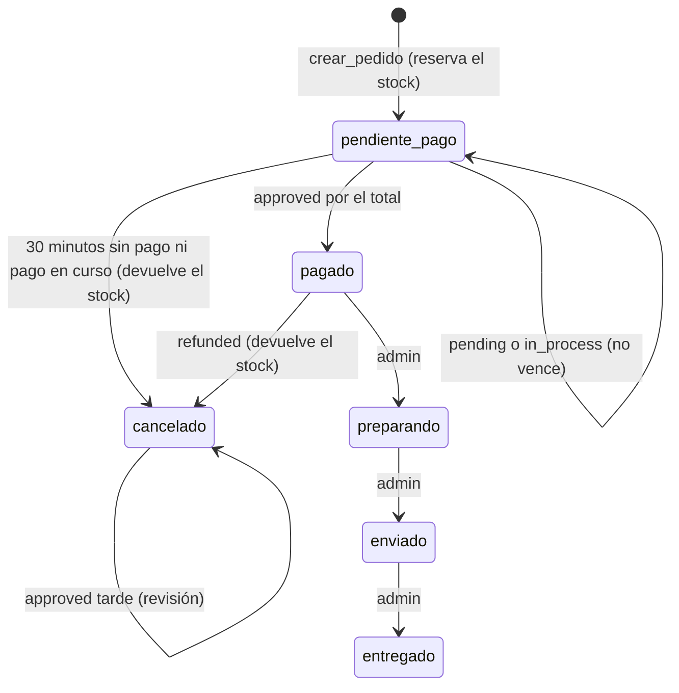

# API de green.

La tienda casi no tiene API: las páginas leen de Supabase en el servidor y las
mutaciones van por Server Actions (`lib/carrito.js`, `lib/checkout.js`,
`lib/cuenta.js`). Bajo `/api/v1` van solo los endpoints que llama alguien de
afuera. Hoy hay uno: el webhook de Mercado Pago.

## Convenciones

- **Base**: `/api/v1`. Cuerpos y respuestas en JSON.
- **Validación**: con [Zod](https://zod.dev), siempre en el servidor. Lo que no
  pasa el esquema responde 400 con qué campo falló.
- **Errores**: todos con la misma forma, armada por el helper de `lib/api.js`
  (`ErrorApi`, `validar` y `conErrores`, que envuelve el Route Handler):

  ```json
  {
    "error": {
      "codigo": "datos_invalidos",
      "mensaje": "Los datos no tienen el formato esperado.",
      "detalles": [{ "campo": "data.id", "mensaje": "El id del pago tiene que ser un número" }]
    }
  }
  ```

  `detalles` aparece solo cuando suma. Cualquier error que no sea un `ErrorApi`
  se loguea y sale como `500` con `codigo: "error_interno"`, sin contar qué
  pasó.

| Código                    | Status | Cuándo                                                  |
| ------------------------- | ------ | ------------------------------------------------------- |
| `datos_invalidos`         | 400    | La query o el cuerpo no pasan el esquema de Zod          |
| `firma_invalida`          | 401    | Falta `x-signature` o no coincide                        |
| `error_interno`           | 500    | Un error nuestro (falta una variable, falló la base…)    |
| `mercadopago_no_responde` | 502    | Mercado Pago no respondió o respondió con error          |

## `POST /api/v1/webhooks/mercadopago`

Recibe los avisos de Mercado Pago (Webhooks, evento **Pagos**) y concilia cada
pago con su pedido. Es la **única** vía por la que un pedido pasa a pagado o
se cancela por una devolución: las páginas a las que vuelve el comprador
(`back_urls`) solo muestran un mensaje.

Código: `app/api/v1/webhooks/mercadopago/route.js`, `lib/mercadopago.js`,
`lib/cobros.js` y la función `conciliar_pago` de
`supabase/migrations/0002_pagos.sql`.

### Qué llega

```
POST /api/v1/webhooks/mercadopago?data.id=123456&type=payment&source_news=webhooks
x-signature: ts=1742505638683,v1=ced36ab6d33566bb1e16c125819b8d840d6b8ef136b0b9127c76064466f5229b
x-request-id: bb56a2f1-6aae-46ac-982e-9dcd3581d08e
Content-Type: application/json

{"action":"payment.updated","api_version":"v1","data":{"id":"123456"},
 "date_created":"2026-10-22T17:32:00Z","id":"123456","live_mode":false,
 "type":"payment","user_id":724484980}
```

`source_news=webhooks` lo agrega la tienda en la `notification_url` de la
preferencia, para recibir solo avisos de Webhooks (firmados) y no los IPN.

### Qué hace

1. **Valida la firma.** De `x-signature` saca `ts` y `v1`, y arma el
   manifiesto `id:<data.id>;request-id:<x-request-id>;ts:<ts>;` (con `data.id`
   de la query, en minúsculas; lo que no llega se saca del manifiesto). Calcula
   el HMAC-SHA256 en hexadecimal con `MP_WEBHOOK_SECRET` y lo compara con `v1`
   en tiempo constante. Si no coincide: **401**. No se mira la antigüedad de
   `ts`: un aviso repetido no hace daño (ver «Idempotencia»).
2. **Mira el tipo** (`type` del cuerpo o de la query). Si no es `payment`,
   responde **200** y no hace nada más.
3. **Valida el id** del pago con Zod (`data.id`, numérico). Si no: **400**.
4. **Consulta el pago** con `GET https://api.mercadopago.com/v1/payments/:id` y
   el Access Token. Del aviso no se usa nada más que el id: el estado, el monto
   y el pedido salen de esta respuesta. Si el pago no existe (el «Simular» del
   panel), responde **200** con `pago_inexistente`.
5. **Concilia** con `conciliar_pago` (ver abajo), llamada con
   `SUPABASE_SECRET_KEY`: es una función `security definer` que solo puede
   ejecutar `service_role`.
6. Responde **200** con lo que hizo.

Todo esto tarda menos de un segundo (las llamadas a Mercado Pago cortan a los
8 s; Mercado Pago espera 22 s). Por eso el pago se procesa **antes** de
responder: si Mercado Pago o la base fallan, el 5xx hace que Mercado Pago
reintente (cada 15 minutos, y después más espaciado). Responder 200 primero y
procesar después perdería el aviso si algo falla.

### Respuestas

| Status | Cuerpo                                            | Cuándo                                         |
| ------ | ------------------------------------------------- | ---------------------------------------------- |
| 200    | `{ "recibido": true, "resultado": "pagado" }`     | Un pago conciliado (ver resultados)            |
| 200    | `{ "recibido": true, "resultado": "ignorado", "tipo": "…" }` | Un evento que no es un pago          |
| 400    | `datos_invalidos`                                 | `data.id` falta o no es numérico               |
| 401    | `firma_invalida`                                  | La firma no coincide                           |
| 500    | `error_interno`                                   | Falta una variable o falló la base             |
| 502    | `mercadopago_no_responde`                         | No se pudo consultar el pago                   |

Resultados (`resultado`): `pagado`, `en_curso`, `rechazado`, `cancelado`,
`revision`, `registrado` (se guardó el estado, sin cambios en el pedido),
`sin_cambios` (el mismo aviso otra vez), `ajeno` (el pago no es de un pedido de
la tienda: un cobro con QR, un link de pago) y `pago_inexistente`.

### La conciliación

`conciliar_pago(pago jsonb)` busca el pedido por `external_reference` (que es el
id del pedido), lo bloquea y registra el pago en `pagos`. Después, según el
estado del pago:

| Estado en Mercado Pago            | El pedido                                                                                  |
| --------------------------------- | ------------------------------------------------------------------------------------------ |
| `approved`                        | Pendiente y el monto es el total en ARS → **pagado**. Si no, revisión (ver abajo)           |
| `pending`, `in_process`, `authorized` | Sigue pendiente y **no vence** mientras tanto (`pago_en_curso`)                        |
| `rejected`, `cancelled`           | Sigue pendiente: se puede **reintentar** hasta que venza                                    |
| `refunded`                        | Si es el pago que lo pagó: **cancelado** y el stock vuelve. Si ya se envió: revisión         |
| `charged_back`                    | Revisión                                                                                   |
| otro (`in_mediation`…)            | Solo se registra                                                                           |

- **El monto**: `transaction_amount` tiene que ser exactamente el `total` del
  pedido, y `currency_id`, `ARS`. Los ítems de la preferencia salen del pedido
  guardado y suman el total, así que una diferencia no debería pasar nunca: si
  pasa, el pedido no se marca pagado.
- **Pagado después de los 30 minutos**: si llega un `approved` y el pedido
  sigue pendiente (nadie lo canceló todavía), se marca pagado. El stock sigue
  reservado, así que no hay problema.
- Al final, `conciliar_pago` llama a `liberar_pedidos_vencidos`: un aviso
  también sirve para devolver el stock de los pedidos vencidos.

### Idempotencia y orden

- Con el pedido bloqueado (`for update`), si el pago ya está en `pagos` con el
  mismo estado y detalle, devuelve `sin_cambios` sin escribir nada. Dos avisos
  iguales que llegan a la vez pasan de a uno: el segundo ve lo que dejó el
  primero.
- Las transiciones dependen del estado del pedido (un `approved` solo paga un
  pedido pendiente; un `refunded` solo cancela el pedido que pagó ese pago),
  así que repetir un aviso no repite el efecto: el stock nunca vuelve dos
  veces.
- Como el pago se consulta en el momento, un aviso viejo trae el estado de hoy.
  Si los avisos llegan desordenados (`refunded` antes que `approved`), el
  primero ya concilia el estado final y el otro da `sin_cambios`.
- `pago_en_curso` está en la fila del pedido, no solo en `pagos`: si
  `liberar_pedidos_vencidos` estaba esperando el lock, al volver a evaluar la
  fila lo ve y no la cancela.

### Revisión: lo que no se resuelve solo

Propuesta: una tabla `pedido_revisiones` (una fila por pago y motivo, con
`unique (pago_id, motivo)` para que un aviso repetido no la duplique). El
pedido no se toca: la tienda decide. Motivos:

| Motivo                  | Qué pasó                                                       | Qué hacer                                                                   |
| ----------------------- | -------------------------------------------------------------- | --------------------------------------------------------------------------- |
| `pago_en_cancelado`     | Llegó un `approved` de un pedido ya cancelado (casi siempre, por vencido) | Si hay stock, reactivar el pedido y descontarlo; si no, devolver el pago desde Mercado Pago |
| `pago_duplicado`        | Un segundo `approved` de un pedido ya pagado                    | Devolver uno de los dos                                                      |
| `monto_distinto`        | El `approved` no es el total en ARS                             | Revisar y devolver                                                           |
| `devolucion_tras_envio` | Se devolvió el pago de un pedido ya enviado                     | El stock no vuelve solo: la mercadería no está en el depósito                 |
| `contracargo`           | El comprador desconoció el pago con la tarjeta                  | Responder la disputa en Mercado Pago                                         |

Con `pago_en_cancelado`, el pedido queda cancelado y el stock no se vuelve a
descontar solo, porque ya pudo venderse. El cliente, en su pedido, lee que
Mercado Pago aprobó un pago cuando el pedido ya estaba cancelado y que se está
revisando. Es poco probable: la preferencia vence junto con el pedido, así que
Mercado Pago no acepta pagos después; queda la carrera de un pago aprobado
justo al límite, o uno que estuvo en proceso y se aprobó tarde.

Hasta que haya panel de admin, se miran en el SQL Editor:

```sql
-- Las pendientes
select r.id, r.motivo, r.creada_en, p.numero, p.estado, p.email, g.id as pago, g.monto
from pedido_revisiones r
join pedidos p on p.id = r.pedido_id
join pagos g on g.id = r.pago_id
where r.resuelta_en is null
order by r.creada_en;

-- Resolver una
update pedido_revisiones
set resuelta_en = now(), nota = 'Devuelto desde Mercado Pago'
where id = 1;
```

Cuando haya admin, un aviso por mail al crear una revisión sería lo siguiente.

## El flujo de pago completo



Los estados del pedido en todo esto:



## Por qué el stock se reserva al crear el pedido y no al pagar

`crear_pedido` descuenta el stock en el momento (con las variantes
bloqueadas) y lo devuelve si el pedido vence a los 30 minutos sin pago. Se
podría esperar al `approved`, pero:

- **Checkout Pro pasa afuera de la tienda.** Entre que se crea la preferencia
  y llega el aviso pasan minutos. Si el stock se descontara recién al pagar,
  dos compradores podrían pagar la última raqueta: al segundo se le cobra algo
  que no hay, y hay que devolverle la plata (con su comisión y su mala
  experiencia). Con la reserva, gana quien confirma primero y nadie paga lo
  que no existe.
- **El webhook no es instantáneo ni seguro.** Puede tardar, reintentarse o
  llegar desordenado. Con la reserva, la disponibilidad no depende de cuándo
  llegue el aviso: el aviso solo cambia el estado del pedido.
- **Los pagos en proceso necesitan stock apartado.** Un `in_process` puede
  aprobarse horas después. Si el stock no estuviera reservado, el `approved`
  caería sobre un pedido que ya no se puede cumplir.
- **El precio queda fijo.** El pedido copia precios y descuentos al crearse, y
  la preferencia sale de ahí: lo que cobra Mercado Pago es exactamente el total
  del pedido, aunque el precio del catálogo cambie mientras se paga.

El costo es stock apartado por pedidos que nunca se pagan. Lo acota el
vencimiento: la preferencia vence a los 30 minutos (Mercado Pago no acepta
pagos después) y `liberar_pedidos_vencidos` devuelve el stock. No hay cron: la
llaman `crear_pedido` y cada aviso del webhook, y el sitio ya muestra «Vencido»
apenas pasan los 30 minutos. Si hiciera falta que el stock vuelva justo a
tiempo, se puede programar con `pg_cron` cada pocos minutos.

## Variables de entorno

Todas solo del servidor: **ninguna lleva `NEXT_PUBLIC_`**, así que nunca llegan
al navegador. `lib/mercadopago.js`, `lib/supabaseServicio.js` y
`lib/cobros.js` importan `server-only`.

| Variable               | Para qué                                                    | De dónde sale                                                                                   |
| ---------------------- | ----------------------------------------------------------- | ----------------------------------------------------------------------------------------------- |
| `MP_ACCESS_TOKEN`      | Crear preferencias y consultar pagos                        | Mercado Pago › Tus integraciones › la aplicación › Credenciales de prueba (después, de producción) |
| `MP_WEBHOOK_SECRET`    | Validar la firma de los avisos                              | Mercado Pago › la aplicación › Webhooks › Configurar notificaciones › clave secreta             |
| `SUPABASE_SECRET_KEY`  | Llamar a `conciliar_pago` y `guardar_preferencia`           | Supabase › Project Settings › API Keys › Secret keys (`sb_secret_…`)                             |

Las de Supabase que ya estaban (`NEXT_PUBLIC_SUPABASE_URL` y
`NEXT_PUBLIC_SUPABASE_PUBLISHABLE_KEY`) siguen igual.

## Puesta en marcha

### Supabase

1. Correr `supabase/migrations/0002_pagos.sql` entero en el SQL Editor,
   **antes** de publicar el código que la usa (la migración es compatible con
   el código anterior).
2. Copiar una Secret key a `SUPABASE_SECRET_KEY`.

### Mercado Pago

1. **La aplicación**: en [Tus integraciones](https://www.mercadopago.com.ar/developers/panel/app),
   «Crear aplicación» › Checkout Pro › API de Preferencias, con un nombre
   («green.»). Al crearla, Mercado Pago crea solo una cuenta de prueba
   vendedora y una compradora.
2. **Credenciales de prueba**: en la aplicación, «Credenciales de prueba» › el
   Access Token (empieza con `APP_USR-`, como el de producción) va a
   `MP_ACCESS_TOKEN`.
3. **El webhook**: en la aplicación, Webhooks › Configurar notificaciones. En
   las dos pestañas (prueba y productivo), la URL
   `https://<dominio de producción>/api/v1/webhooks/mercadopago` y el evento
   **Pagos**. Guardar genera la clave secreta: «Revelar» y copiarla a
   `MP_WEBHOOK_SECRET`. La preferencia manda su propia `notification_url` (la
   misma ruta, con `?source_news=webhooks`), que tiene prioridad; la del panel
   hace falta para tener el secret.
4. **Probarlo**: «Simular» en esa misma pantalla, con cualquier Data ID, tiene
   que responder 200 con `"resultado": "pago_inexistente"`.

### Una compra de prueba

En una ventana de incógnito, entrar a la tienda (la de Vercel, no
localhost), comprar y, en Checkout Pro, ingresar con la **cuenta de prueba
compradora** (usuario y contraseña en la aplicación › Cuentas de prueba; si
pide un código por mail, son los 6 dígitos que figuran ahí). Nunca con una
cuenta real: mezclar una cuenta real con credenciales de prueba falla.

Tarjeta: Mastercard `5031 7557 3453 0604`, código `123`, vencimiento `11/30`,
DNI `12345678`. El nombre del titular elige el resultado: `APRO` aprobado,
`OTHE` rechazado, `CONT` pendiente (más en la documentación de Mercado Pago).

### En local

`npm run dev` sirve para todo menos el aviso: las `back_urls` vuelven a
`http://localhost:3000` (sin `auto_return`, que la tienda solo pide con
HTTPS: hay que tocar «Volver al sitio»), pero Mercado Pago no puede avisarle a
localhost (la `notification_url` también va solo con HTTPS), así que el pedido
queda pendiente. Para probar el webhook en local,
abrir el sitio por un túnel HTTPS (cloudflared, ngrok): el origen de la
preferencia pasa a ser el del túnel y la `notification_url` también.

### Pasar a producción

Activar las credenciales de producción de la aplicación (pide los datos del
negocio), cambiar `MP_ACCESS_TOKEN` en Vercel por el Access Token de
producción y volver a publicar. El webhook y su secret son los de la misma
aplicación.

### Vercel

En Settings › Environment Variables, cargar `MP_ACCESS_TOKEN`,
`MP_WEBHOOK_SECRET` y `SUPABASE_SECRET_KEY` (marcadas como Sensitive) para
Production y, si se prueba en previews, para Preview. Las previews con
Deployment Protection responden 401 a Mercado Pago: el webhook se prueba en
producción. Después de cargarlas, volver a publicar.
