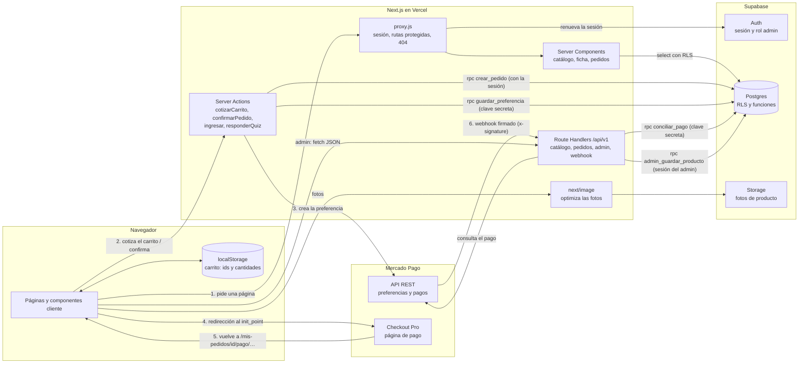
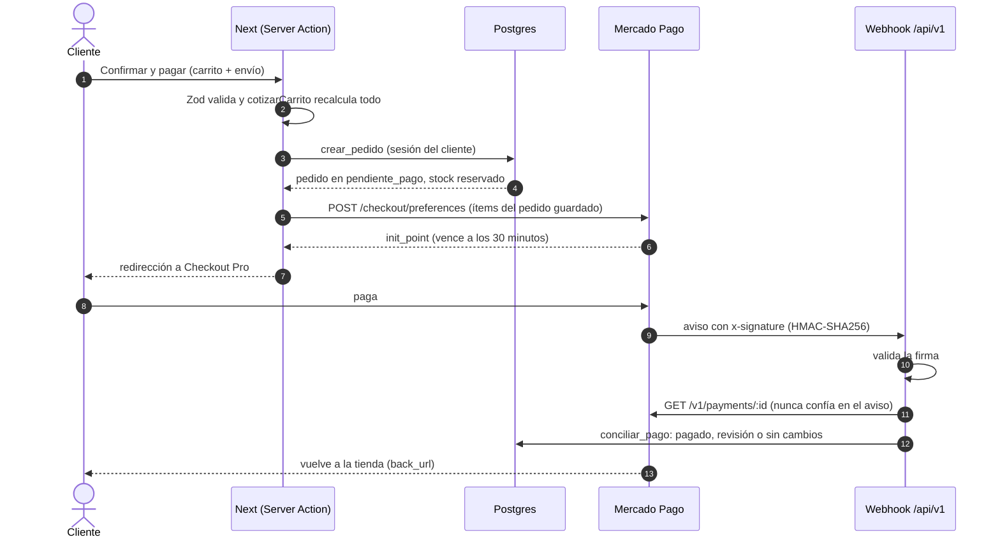
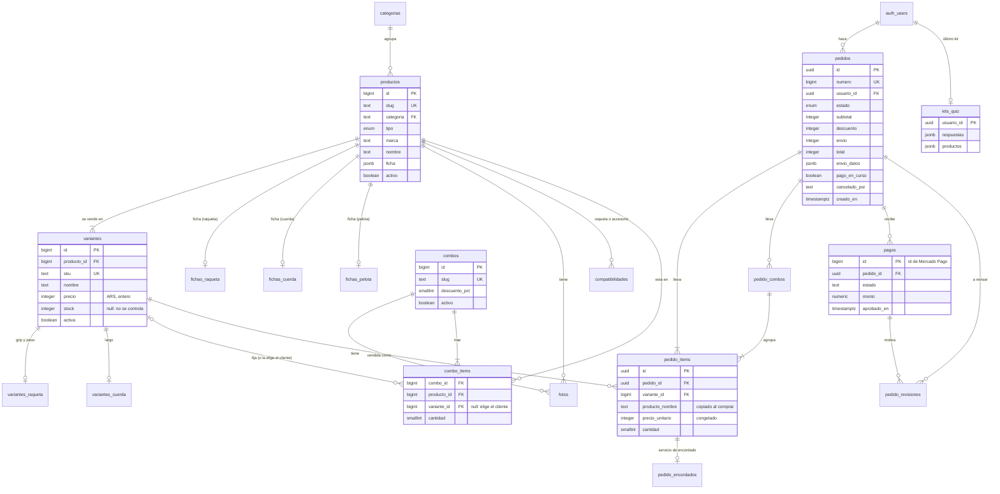
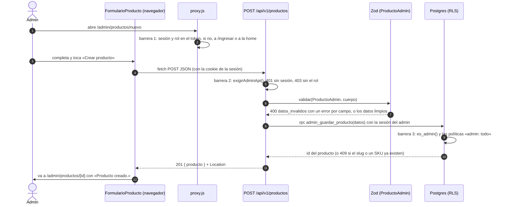

# Arquitectura de green.

green. es una tienda online de tenis: raquetas, pelotas, cuerdas y grips, y
bolsos de marcas reales, más combos armados por la tienda con descuento. Tiene
catálogo con fichas técnicas, carrito, cuenta, checkout con Mercado Pago,
pedidos, un quiz que recomienda un kit, encordado de raquetas y un panel de
administración. Este documento resume cómo está hecha y por qué. El detalle
de cada parte está en:

- `docs/API.md`: los endpoints, el pago, la seguridad.
- `DESIGN.md`: el sistema de diseño.
- `docs/TESTING.md`: los tests.
- `docs/CI.md`: el pipeline.

**Orden sugerido para una exposición de 10 minutos:**

| Minutos | Tema |
| ------- | ---- |
| 1 | Qué es y el stack |
| 2 | El diagrama de arquitectura y el camino de una compra |
| 2 | La base: el diagrama, RLS y las funciones |
| 2 | El CRUD del admin de punta a punta, con las tres barreras |
| 2 | La historia en etapas |
| 1 | Calidad y limitaciones |

## 1. Stack

| Tecnología | Para qué se usa | Por qué se eligió |
| ---------- | --------------- | ----------------- |
| **JavaScript** (sin TypeScript) | Todo el código, del navegador a los scripts | Menos configuración y un solo lenguaje. Los datos que importan se validan con Zod en el servidor, que es donde el tipado no alcanza igual: lo que llega de afuera se valida en tiempo de ejecución |
| **Node.js 24** | Correr Next, los scripts y los tests (`.nvmrc`) | Una versión LTS, la misma en local y en CI |
| **Next.js 16** (App Router) | Rutas, Server Components, Server Actions, Route Handlers (`/api/v1`) y `proxy.js` | Front y back en un solo proyecto. Los precios y el stock se calculan en el servidor sin una API aparte, y se publica en Vercel sin configurar nada |
| **React 19** | La interfaz; componentes cliente donde hay interacción (carrito, ficha, quiz, admin) | Lo trae Next. `useActionState` para formularios con Server Actions y `useSyncExternalStore` para el carrito compartido entre pestañas |
| **CSS Modules** + variables CSS | Estilos por componente, con los tokens del sistema de diseño en `app/globals.css` | Clases con alcance local sin otra herramienta. El sistema de `DESIGN.md` vive en variables, no en clases utilitarias (sin Tailwind) |
| **next/font** (Archivo, Inter Tight) | Las dos tipografías, servidas desde el propio sitio | Sin pedidos a Google Fonts desde el navegador y sin salto de layout al cargar |
| **Supabase Postgres** | Catálogo, pedidos, pagos y kits del quiz | Relacional, con transacciones y bloqueos para no vender dos veces la última unidad. RLS y funciones ponen las reglas en la base misma |
| **Supabase Auth** (`@supabase/ssr`) | Cuentas, sesión en cookies, recuperar la contraseña y el rol de admin (`app_metadata`) | Viene con la base. La sesión que la base reconoce (`auth.uid()`, `es_admin()`) es la misma que usa Next |
| **Supabase Storage** | Las fotos de producto (bucket `productos`) | En el mismo proyecto y con URL pública. `next/image` las optimiza |
| **`@supabase/supabase-js`** | El cliente de la base en el servidor, los scripts y la limpieza de los tests | El oficial: consultas con RLS y llamadas a funciones (`rpc`) |
| **Mercado Pago Checkout Pro** (API REST, sin SDK) | Cobrar: preferencia, redirección y webhook | El medio de pago de Argentina. La página de pago es de Mercado Pago, así que la tienda nunca toca datos de tarjetas. Va por REST con `fetch`: son tres llamadas y no hace falta otra dependencia |
| **Zod 4** | Validar todo lo que entra al servidor: la API, las Server Actions y el webhook | Esquemas que validan y convierten a la vez, con errores por campo y mensajes en castellano. Se compararon Valibot y Ajv (ver `docs/API.md`) |
| **`server-only`** | Marcar módulos que no pueden llegar al navegador (esquemas, Mercado Pago, clave secreta) | Si un componente cliente los importa, el build falla |
| **Three.js**, **@react-three/fiber**, **drei** | La raqueta 3D de «Anatomía de una raqueta», atada al scroll | Three.js con componentes de React. El modelo se optimiza con glTF Transform (`npm run modelo:raqueta`) |
| **sharp** | Optimizar imágenes (`next/image` lo usa en el servidor) y generar AVIF y WebP de las fotos de ambiente (`npm run fotos`) | Ya viene con Next; es el estándar para procesar imágenes en Node |
| **@imgly/background-removal-node** | Recortar el fondo de las fotos de producto (`npm run fotos:productos`) | Corre en la computadora, sin pagar un servicio por foto |
| **ffmpeg** | Cortar y comprimir los clips del hero en WebM y MP4 (`npm run video:hero`) | La herramienta estándar para video; el script deja cada archivo bajo un tope de peso |
| **ESLint** (`eslint-config-next`) | Lint de todo el código | La configuración oficial de Next, con las reglas de React y de Core Web Vitals |
| **Playwright** | Tests E2E en Chromium contra el build de producción | Locators semánticos (`getByRole`), espera automática y trazas para ver qué pasó. Next tiene una guía oficial para usarlo |
| **GitHub Actions** | CI: lint, build y E2E en cada push y PR | Está en el mismo lugar que el código, es gratis para un repo público y los secrets quedan fuera del YAML |
| **Vercel** | Hosting y deploy con cada push | La plataforma de Next: deploys por push, previews y funciones sin configurar servidores |
| **Vercel Speed Insights** | Core Web Vitals (LCP, INP, CLS) de las visitas reales | Un componente y un switch en el panel; mide lo que vive cada visitante, no una prueba de laboratorio |
| **Pexels / Unsplash** | Los videos del hero y las fotos de ambiente, con crédito en el footer | Licencias que permiten el uso en un sitio comercial |
| **Mermaid** | Los diagramas de la documentación | GitHub los dibuja directo desde el Markdown, sin imágenes que se desactualicen |

## 2. Arquitectura

Cada página se arma en el servidor. El navegador guarda solo el carrito (ids y
cantidades) y nunca decide un precio. Cuatro piezas de Next reciben al
navegador:

- **`proxy.js`** (el middleware de Next 16) corre antes de las rutas de
  cuenta, compra y catálogo. Renueva la sesión y redirige lo protegido a
  `/ingresar`. Además, responde 404 de verdad cuando un producto, combo o
  pedido no existe.
- **Server Components**: las páginas. Leen el catálogo con la clave
  publicable y los pedidos con la sesión del usuario.
- **Server Actions**: lo que hace el usuario. Cotizar el carrito, confirmar
  el pedido, ingresar, guardar el kit del quiz.
- **Route Handlers** (`/api/v1`): la puerta para lo que llega de afuera. El
  panel de admin (con `fetch`), el webhook de Mercado Pago y cualquier cliente
  de la API.

### El camino de una compra

Tres reglas cruzan todo el diseño:

- **El servidor decide los precios.** El carrito guarda ids y cantidades,
  `cotizarCarrito` recalcula todo con Supabase, `crear_pedido` lo vuelve a
  calcular en la base y la preferencia de Mercado Pago sale del pedido
  guardado.
- **La base es la última barrera.** Aunque la página o la API fallen, RLS y
  las funciones deciden qué se puede leer y escribir.
- **La clave secreta solo ejecuta funciones.** `service_role` no tiene
  permisos sobre ninguna tabla: con `SUPABASE_SECRET_KEY` solo se puede
  llamar a `conciliar_pago`, `guardar_preferencia`,
  `liberar_pedidos_vencidos` y `guardar_foto`. El admin escribe con su propia
  sesión.

## 3. Base de datos

Once migraciones en `supabase/migrations/`, que se corren a mano en el SQL
Editor de Supabase, más `supabase/seed.sql` con el catálogo.

Decisiones del modelo:

- **Los precios son enteros en pesos.** Así no hay errores de redondeo con
  decimales.
- **El pedido copia todo al comprar** (nombres, precios, descuentos): un
  cambio de catálogo no altera un pedido viejo.
- **Las fichas son tipadas solo para lo que se consulta.** La raqueta, la
  cuerda y la pelota tienen tablas propias porque el quiz, el encordado y los
  medidores filtran por sus datos. Grips y bolsos llevan una ficha libre en
  `jsonb`.
- **Los combos no guardan precio.** Se calcula con sus ítems y el descuento,
  con la misma cuenta en el carrito y en `crear_pedido`.

### Políticas RLS principales

Todas las tablas tienen RLS. Además, cada rol tiene solo los `GRANT` que
necesita: el proyecto no los da por defecto, y una política sin `GRANT` no
alcanza.

| Política | Tablas | Quién | Qué deja |
| -------- | ------ | ----- | -------- |
| **lectura pública** | `productos`, `variantes`, `combos`, `fotos`, `categorias`, fichas, `compatibilidades`, `combo_items` | `anon` y `authenticated` | Leer solo lo activo: un producto con `activo = false` no existe para la tienda, y sus variantes, fotos y fichas tampoco |
| **admin: todo** | Las mismas tablas del catálogo | `authenticated` con `es_admin()` | Leer, crear, cambiar y borrar. `es_admin()` mira `{"rol": "admin"}` en el token, que solo se escribe con la clave secreta |
| **dueño o admin** | `pedidos`, `pedido_items`, `pedido_combos`, `pedido_encordados`, `pagos` | `authenticated` | Leer los pedidos propios (`usuario_id = auth.uid()`); el admin, todos. Nadie los inserta directo: solo `crear_pedido` |
| **admin actualiza** | `pedidos` (solo la columna `estado`) | `authenticated` con `es_admin()` | Pasar un pedido a «en preparación» o «enviado» |
| **admin lee** | `pedido_revisiones` | `authenticated` con `es_admin()` | Ver los pagos que la conciliación no resolvió sola |
| **dueño / dueño crea / dueño cambia** | `kits_quiz` | `authenticated` | Ver, crear y cambiar solo el kit propio |

### Funciones de la base

Las que escriben con privilegios son `security definer`, con `search_path`
vacío y `execute` solo para el rol que corresponde.

| Función | Quién la ejecuta | Qué hace |
| ------- | ---------------- | -------- |
| `crear_pedido` | `authenticated` | Crea el pedido del usuario de la sesión en una transacción: bloquea las variantes, recalcula precios y descuentos (nunca los recibe), valida stock y encordados, descuenta el stock y deja el pedido en `pendiente_pago` |
| `conciliar_pago` | `service_role` | Aplica un pago de Mercado Pago (el que devolvió su API) al pedido: lo marca pagado, lo reactiva si se aprobó a tiempo o lo manda a revisión (monto distinto, pago duplicado, devolución, contracargo). Es idempotente: el mismo aviso dos veces no cambia nada |
| `admin_guardar_producto` | `authenticated` (corta si no es admin) | Crea o actualiza un producto con su ficha y sus variantes en una transacción. Corre con los permisos de quien llama (`security invoker`), así que RLS aplica igual |
| `guardar_foto` | `service_role` | Anota una foto de producto o combo con la ruta que arma ella (`recortes/<slug>-<n>.webp`); la usa `npm run fotos:productos` |
| `liberar_pedidos_vencidos` | `pg_cron` cada 10 minutos, `service_role`, y adentro de `crear_pedido` y `conciliar_pago` | Cancela los pedidos pendientes de más de 30 minutos sin un pago en curso y devuelve su stock |
| `guardar_preferencia` | `service_role` | Guarda la preferencia de Checkout Pro del pedido para reusarla mientras se pueda pagar |
| `cancelar_pedido` | `authenticated` | Cancela un pedido propio pendiente y devuelve el stock en el momento; hoy la usa la limpieza del test del checkout |
| `es_admin` | todos | `true` si el token trae el rol de admin; la usan las políticas |

## 4. Un CRUD de punta a punta: crear un producto

El admin entra a `/admin/productos/nuevo`, completa el formulario y toca
«Crear producto». Pasa por tres barreras, una en cada capa:

**El endpoint.** `POST /api/v1/productos` (`app/api/v1/productos/route.js`).
El handler va envuelto en `conErrores` (`lib/api.js`), que convierte
cualquier error en el JSON `{ "error": { codigo, mensaje, detalles } }` y lo
registra en el log. Pasa por cuatro pasos:

1. **Pide el rol.** `exigirAdminApi()` pregunta el usuario a Supabase Auth.
   Sin sesión responde `401 sin_sesion`; con sesión pero sin el rol, `403
   sin_permiso`. Devuelve un cliente con la sesión del admin, nunca con la
   clave secreta.
2. **Lee el cuerpo.** `leerJson`: si no es JSON, `400 json_invalido`.
3. **Valida.** `validar(ProductoAdmin, cuerpo)` (`lib/esquemasAdmin.js`).
4. **Guarda.** `guardarProducto` (`lib/admin.js`) llama a
   `admin_guardar_producto` y devuelve `201` con el producto guardado y el
   header `Location`.

**Qué valida Zod** (los mismos límites que los `check` de la base, así el error
sale por campo y no como un error de la base):

- `categoria` y `tipo` de las listas, y el tipo tiene que ir en esa categoría:
  en Pelotas solo va `pelota`.
- `marca` (40), `nombre` (80) y `descripcion` (600): texto sin espacios de más
  y no vacío.
- `slug`: minúsculas, números y guiones (`babolat-pure-drive`), hasta 120.
- `ficha`, con la forma de su tipo:
  - raqueta: cabeza, largo, balance, patrón, rigidez, tensión mínima y máxima,
    nivel y perfil;
  - cuerda: material, calibre con dos decimales y perfil;
  - pelota: superficie y uso;
  - lo demás: filas de rótulo y valor.
- `variantes`, de 1 a 30:
  - `sku` en mayúsculas con guiones;
  - `nombre` hasta 60;
  - `precio`, entero de 1 a 100.000.000;
  - `stock`, entero de 0 a 100.000 o `null`;
  - grip (0 a 5) y peso (220 a 360 g) obligatorios en las raquetas, y largo en
    las cuerdas;
  - ni el SKU ni el nombre se repiten.

Si algo no pasa, responde `400 datos_invalidos` con un detalle por campo
(`variantes.0.precio: Tiene que ser un número entero…`), y el formulario lo
muestra debajo de ese campo.

**Qué lo permite en la base.** `admin_guardar_producto` es `security invoker`:
corre con los permisos del admin.

- **Primera verificación:** si `es_admin()` da falso, corta con `42501`.
- **Las políticas:** después, cada `insert` en `productos`, `variantes`,
  `fichas_*` y `variantes_*` pasa por la política **admin: todo** (`for all
  to authenticated using (es_admin()) with check (es_admin())`), con el
  `GRANT insert, update, delete` de `0004_admin.sql`.
- **Una transacción:** si el slug o un SKU ya existen, la base responde
  `23505`, `errorDeBase` lo traduce a `409 ya_existe` y no queda nada a
  medias.

**El resto del CRUD:**

| Operación | Endpoint |
| --------- | -------- |
| Leer (el listado del admin, con búsqueda) | `GET /api/v1/productos?todos=1` |
| Leer uno, para editarlo | `GET /api/v1/productos/[id]` |
| Cambiar | `PATCH /api/v1/productos/[id]` (`CambiosProducto`, mismo guardado) |
| Borrar | `DELETE /api/v1/productos/[id]`: si tiene pedidos o está en un combo, responde `409 en_uso` y se desactiva en vez de borrarlo |

En la tienda, el producto nuevo aparece por la política **lectura pública**
apenas queda `activo`.

## 5. Historia del proyecto

110 commits entre el 1 de octubre y el 8 de noviembre de 2026, y 11
migraciones. Hubo tres conceptos antes de tenis: la base técnica se armó
cuando el concepto ya estaba firme.

### 1. Arranque y dos cambios de concepto (1 al 9 de octubre)

`create-next-app`, después «Boldy» (zapatillas con lanzamientos) y «La
Montañita» / «Amargo» (una tienda de mate), con un mate 3D en el hero y
después un video de fondo.

- **Decisión:** los productos en un array en memoria (`lib/productos.js`),
  para iterar el diseño sin backend. `DESIGN.md` pasa a ser el contrato
  visual del proyecto.
- **Descartado:** los dos conceptos, y el hero 3D del mate, que se cambió por
  un video de fondo.

### 2. green., una tienda de tenis (15 y 16 de octubre)

Sistema de diseño nuevo, la vitrina con el producto solo sobre fondo de
estudio y «Anatomía de una raqueta» con la cámara atada al scroll.

- **Decisión:** cuatro categorías más combos; la anatomía en 3D con
  `@react-three/fiber`.
- **Descartado:** zapatillas y ropa en el catálogo (quedó el equipamiento), y
  la anatomía con estilo «inflado» sobre azul de cancha.

### 3. Supabase: catálogo, carrito y cuenta (16 al 19 de octubre)

`0001_esquema.sql` con el catálogo, los combos y los pedidos, RLS, `GRANT`
explícitos y `crear_pedido`, probado antes en PGlite. El catálogo se lee de
Supabase, el carrito vive en el navegador y la cuenta usa Supabase Auth con
cookies y `proxy.js`.

- **Decisión:** el carrito guarda solo ids y cantidades, y el servidor cotiza
  todo. El stock se reserva al crear el pedido, en una transacción con las
  variantes bloqueadas. Las fichas son tipadas para raqueta y cuerda.
- **Descartado:** que el navegador mande o guarde precios, y una sola ficha
  `jsonb` para todo: `crear_pedido` valida la tensión del encordado contra
  el rango de la ficha de la raqueta, y eso pide columnas de verdad.

### 4. Pagos y API (22 y 23 de octubre)

Checkout Pro con preferencia, webhook firmado y `conciliar_pago`
(`0002_pagos.sql`), la reactivación de un pedido pagado a tiempo (`0003`), y
`/api/v1` con Zod y errores centralizados.

- **Decisión:** Mercado Pago por REST, el webhook consulta el pago a Mercado
  Pago en vez de creerle al aviso, y la conciliación también se hace al volver
  a la tienda (por `external_reference`) por si el aviso no llega.
- **Descartado:** el SDK de Mercado Pago, la `notification_url` en la
  preferencia (los avisos reales llegaban con una firma que no validaba: se
  pasó a la URL del panel), descontar el stock recién al pagar (dos personas
  podían pagar la última raqueta), y Valibot y Ajv frente a Zod.

### 5. Rediseño y microanimaciones (23 al 25 de octubre)

`DESIGN.md` reescrito: blanco, hormigón y negro con un único acento, Archivo
en los titulares e Inter Tight en el texto. Hubo una página `/muestra`
temporal para probar todo junto, y después microanimaciones inspiradas en
Kinetics.

- **Decisión:** un solo color, funcional (las acciones), con los contrastes
  medidos.
- **Descartado:** las superficies de color del tenis (polvo, cancha, césped)
  y las fotos inclinadas. Más tarde, la tipografía monoespaciada.

### 6. Administración, quiz y fotos (25 al 28 de octubre)

`/admin` con productos y pedidos contra la API (`0004_admin.sql`), 404 reales
desde el proxy, el quiz de seis preguntas con `kits_quiz` (`0005`),
`guardar_foto` (`0006`), el encordado como línea del carrito y la ficha nueva
con medidores.

- **Decisión:** el rol de admin en `app_metadata` (lo lee igual Next que la
  base). El admin escribe con su sesión y RLS es la última barrera. La clave
  secreta solo ejecuta funciones. El quiz recomienda por reglas de puntaje en
  `lib/quiz.js`: puras y explicables, cada producto dice por qué.
- **Descartado:** escribir el catálogo con la `service_role` (saltea RLS),
  darle a la clave secreta permisos sobre las tablas, y `notFound()` en la
  página para el 404 (con el streaming, el 200 ya había salido).

### 7. Pulido del catálogo (29 de octubre al 6 de noviembre)

Fotos de producto en 4:5, el hero con tres clips en secuencia, una foto por
variante (`0007`), bolsos con una sola opción (`0008`) y cuatro combos nuevos
(`0009`) con la imagen armada en el código.

- **Decisión:** la imagen de cada combo se compone con las fotos de sus
  productos, así cambia sola si cambia una foto.
- **Descartado:** una imagen por combo hecha a mano, y el hero con un solo
  clip en loop.

### 8. Calidad y cierre (7 y 8 de noviembre)

Tests E2E con Playwright, `cancelar_pedido` (`0010`) para que el test del
checkout limpie lo que crea, CI en GitHub Actions y Speed Insights. Al
final, el encordado agrupado con su raqueta en todo lo que muestra un pedido,
y `liberar_pedidos_vencidos` programada con `pg_cron` cada 10 minutos
(`0011`).

- **Decisión:** los tests corren contra el build de producción y usan locators
  semánticos. El CI corre solo los tests que leen, con dos secrets públicos de
  Supabase. El encordado se agrupa con lo que la base ya guardaba
  (`pedido_encordados` sabe qué raqueta encorda cada servicio), sumando
  campos a la API sin cambiar los que había.
- **Descartado:** correr en CI el test que crea pedidos, limpiar con la clave
  secreta (se usa la sesión de la cuenta de prueba) y armar el build dos veces
  en CI. Para el encordado, una migración nueva (no hacía falta) y sacar la
  cuerda y el servicio de la lista de la API (rompía a quien la usa).

## 6. Calidad

- **Tests E2E** (`e2e/`, Playwright, Chromium): quince tests.
  - Ocho recorren la tienda: la home, la grilla de Raquetas hasta una ficha,
    grip y peso con una combinación agotada, el carrito con el total, el
    quiz, la protección de `/checkout`, el checkout de dos raquetas (una
    encordada) hasta Mercado Pago con el pedido agrupado, y el 404 de un
    producto.
  - Dos prueban la API de administración: 401 sin sesión y 403 con sesión
    sin el rol.
  - Cuatro prueban, sin navegador, cómo se agrupa el encordado con su
    raqueta en las líneas del pedido (`lineasDe`).
  - El del checkout escribe en la base (crea un pedido) y lo cancela al
    terminar. Lleva el tag `@escribe-en-base`.
  - Ver [`docs/TESTING.md`](TESTING.md), que suma seis casos de prueba
    manuales y dos reportes de bug.
- **CI** (`.github/workflows/ci.yml`): en cada push a `main` y en cada PR,
  `npm ci`, lint, build y los tests que no escriben en la base, con solo dos
  secrets (la URL y la clave publicable de Supabase). Si fallan, sube el
  reporte y las trazas para el Trace Viewer. El badge está arriba del README.
  Ver [`docs/CI.md`](CI.md).
- **Speed Insights**: Core Web Vitals de las visitas reales, en el panel de
  Vercel (hay que activarlo ahí una vez).

### Dos verificaciones de seguridad

- **Un usuario sin rol de admin recibe 403, no 401.**
  - Todos los endpoints de administración pasan primero por `exigirAdminApi()`:
    `GET ?todos=1`, `POST`, `GET /[id]`, `PATCH` y `DELETE` de productos, y
    `GET ?todos=1` y `PATCH` de pedidos.
  - `e2e/admin.spec.js` lo prueba con requests reales:
    - sin sesión, los siete responden `401 sin_sesion`;
    - con la cuenta de prueba (sin el rol), `403 sin_permiso`;
    - `/admin` lleva a la home.
  - Los cuerpos del test están armados para que, si la protección fallara, no
    se escriba nada.
  - Un pedido ajeno, en cambio, da 404 y no 403 a propósito: no confirma que
    ese id exista (ver `docs/API.md`).
- **Los textos del admin se muestran como texto.**
  - No hay `dangerouslySetInnerHTML` ni `innerHTML` en el proyecto: React
    escapa todo lo que viene de la base (nombre, descripción, filas de la
    ficha, mensajes de error).
  - Los links que salen de datos de la base se arman siempre como
    `/producto/<slug>`, y el slug solo acepta minúsculas, números y guiones:
    no puede ser un `javascript:`.
  - Las fotos salen de rutas que arma la base (`guardar_foto`), no de una URL
    que escriba el admin.

## 7. Limitaciones conocidas

- **Mercado Pago está en modo prueba.** Se cobra con las credenciales de
  prueba y la cuenta compradora de prueba. Pasar a producción es activar las
  credenciales productivas, cambiar `MP_ACCESS_TOKEN` en Vercel y volver a
  publicar.
- **El envío no se cotiza.** `crear_pedido` pone el envío en 0 y el resumen
  dice «Gratis»: el costo de envío quedó para otro paso.
- **Los medidores son estimados.** Potencia, Control y Confort salen de una
  fórmula sobre la ficha (`lib/medidores.js`): cabeza, rigidez, peso y el
  perfil que carga la tienda. Son una guía para comparar productos de la
  tienda entre sí, no una medición.
- **Cualquier cuenta puede reservar stock.** Un pedido sin pagar aparta el
  stock entre 30 y 40 minutos: vence a los 30 y `pg_cron` lo libera en los 10
  siguientes (`0011`). No hay un límite de pedidos pendientes por usuario.
- **Las fotos de producto no son propias.** Muestran productos de marcas
  reales; para vender de verdad hacen falta las del distribuidor, con permiso
  de uso, o fotos propias. Las de ambiente y los videos son de Pexels y
  Unsplash, con crédito.
- **El panel de admin es parcial.** Hace productos y estados de pedido. Los
  combos se cargan por migración. Las revisiones de pagos
  (`pedido_revisiones`) se miran en el SQL Editor y las devoluciones se hacen
  desde Mercado Pago.
- **No hay mails propios.** La tienda no manda confirmación de pedido ni aviso
  de envío; solo existe el mail de recuperación de contraseña de Supabase
  Auth.
- **Los tests usan la base real.** No hay una base de staging: el CI lee el
  catálogo de producción (sin escribir) y un cambio de catálogo puede romper
  un test. Tampoco hay tests unitarios, aunque `lib/quiz.js` y
  `lib/medidores.js` son funciones puras listas para tenerlos.
- **Faltan encabezados de seguridad.** No hay una Content Security Policy ni
  otros encabezados configurados en `next.config.mjs`.
- **«Armá tu raqueta» está pendiente.** El armador por pasos, la mecánica
  principal pensada para la tienda, va en un pedido aparte.
